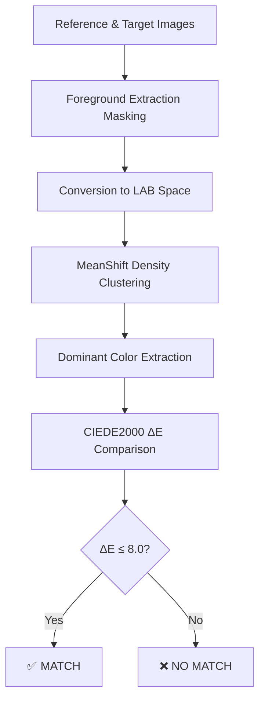
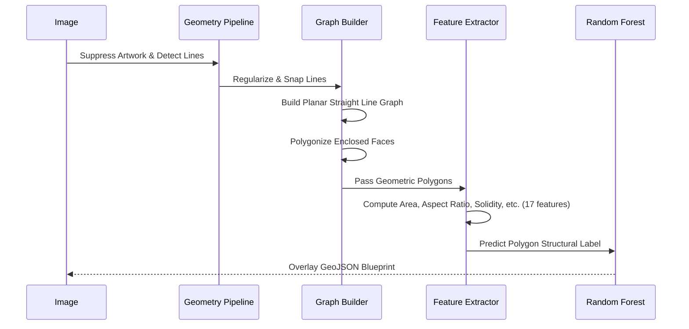
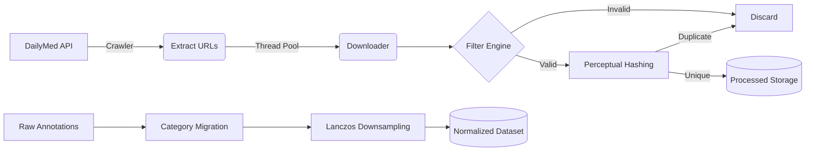

<div align="center">

# 🚀 Silvertouch Technologies Internship Portfolio

**Advanced Computer Vision, Geometric Machine Learning, Data Engineering, and Semantic AI Pipelines**

[](https://www.python.org/downloads/)
[](https://opencv.org/)
[](https://scikit-learn.org/)
[](https://github.com/facebookresearch/faiss)
[](https://huggingface.co/)
[]()

*A comprehensive technical showcase of real-world pharmaceutical packaging analysis, scalable data engineering, and semantic AI systems developed during a professional technology internship.*

[Overview](#-executive-summary) • [Architecture](#-architecture-journey) • [Projects](#-project-showcase) • [Tech Stack](#-technology-stack) • [Getting Started](#-getting-started)

</div>

---

## 📋 Table of Contents

<details open>
<summary><strong>Expand / Collapse Contents</strong></summary>

- [Executive Summary](#-executive-summary)
- [Architecture Journey](#-architecture-journey)
- [Project Showcase](#-project-showcase)
  - [Task 1: Perceptual Text Color Analysis](#1️⃣-task-1--perceptual-text-color-analysis)
  - [Task 2: Structural Packaging Intelligence](#2️⃣-task-2--structural-packaging-intelligence)
  - [Task 3: Dataset Engineering Pipeline](#3️⃣-task-3--dataset-engineering-pipeline)
  - [Task 4: Semantic SQL Generation & Retrieval](#4️⃣-task-4--semantic-sql-generation--retrieval)
- [Technology Stack](#-technology-stack)
- [Skills Demonstrated](#-skills-demonstrated)
- [Engineering Principles](#-engineering-principles)
- [Getting Started](#-getting-started)
- [Challenges & Learnings](#-challenges--learnings)
- [Future Roadmap](#-future-roadmap)
</details>

---

## 🎯 Executive Summary

During my internship at **Silvertouch Technologies**, I focused on designing, architecting, and deploying sophisticated AI pipelines to solve complex problems in pharmaceutical packaging analysis and semantic data retrieval. This repository serves as a professional portfolio documenting the complete lifecycle of these engineered solutions.

The internship traversed multiple advanced domains, including **Computer Vision (CV)**, **Geometric Machine Learning**, **Data Engineering**, and **Information Retrieval (IR) / NLP**. Instead of relying solely on black-box deep learning models, the projects heavily emphasize hybrid approaches—combining deterministic algorithms (like Planar Straight Line Graphs and morphological geometry) with statistical machine learning (Random Forests) and perceptual clustering (MeanShift in LAB space).

---

## 🏗️ Architecture Journey

The projects form a continuous, integrated AI/ML lifecycle. Rather than solving each problem independently, the projects build upon each other, demonstrating how modern AI systems integrate multiple technologies into cohesive platforms.


---

## 🏆 Project Showcase

### 1️⃣ Task 1 — Perceptual Text Color Analysis
> **Domain:** Computer Vision & Color Science | **Status:** ✅ Complete

**Problem:** Pharmaceutical packaging quality assurance requires verifying that printed text colors match design specifications. Simple color comparisons (like Euclidean distance in RGB space) fail because RGB is not perceptually uniform. Lighting anomalies and background gradients can drastically alter standard pixel values.

**Solution:** A perception-aware comparison pipeline that mimics human color perception. It maps colors into the perceptually uniform **LAB color space**, groups them via density algorithms, and scores similarities using the **CIEDE2000 (ΔE)** industry standard.

<details>
<summary><strong>View Workflow & Details</strong></summary>



* **Technologies:** OpenCV, NumPy, scikit-learn (MeanShift), colour-science.
* **Engineering Decisions:** Chose MeanShift over K-Means because we cannot predict how many ink colors exist on a crop; MeanShift finds density peaks dynamically. LAB space isolates luminance from color channels, making it highly resistant to lighting variations.
* **Deliverable:** `outputs/comparison_dashboard.png` showing masks, clusters, swatches, and ΔE metrics.
</details>

---

### 2️⃣ Task 2 — Structural Packaging Intelligence
> **Domain:** Computer Vision & Geometric ML | **Status:** ✅ Complete

**Problem:** Pharmaceutical cartons contain structural elements like panels, fold lines, dust flaps, and glue tabs. While modern Deep Learning is excellent at finding objects, it outputs wavy boundaries. Packaging and manufacturing require strict, mathematically perfect geometric polygons.

**Solution:** A geometry-first computer vision pipeline designed to reconstruct carton structure directly from images. It uses a hybrid approach: a deterministic mathematical pipeline to build a Planar Straight Line Graph (PSLG), and a Machine Learning classifier trained on geometric properties to identify the components.

<details>
<summary><strong>View Workflow & Details</strong></summary>



* **Technologies:** OpenCV, Shapely, NumPy, scikit-learn (Random Forest), GeoJSON.
* **Engineering Decisions:** By enforcing a PSLG, we guarantee no polygons overlap and edges are shared cleanly—mimicking CAD files. Extracted 17 geometric features instead of passing raw pixels to a CNN, allowing a lightweight, explainable Random Forest.
* **Deliverable:** Structural overlays, GeoJSON partition data (`segments.json`), and trained `.joblib` classification models.
</details>

---

### 3️⃣ Task 3 — Dataset Engineering Pipeline
> **Domain:** Data Engineering | **Status:** ✅ Complete

**Problem:** Machine learning systems depend on high-quality datasets. Manual collection is unscalable, and pharmaceutical databases are fraught with duplicate entries, irrelevant logos, and varying image resolutions that break neural network memory constraints.

**Solution:** A comprehensive, multi-threaded data engineering platform combining web scraping of the FDA's DailyMed database, perceptual deduplication via image hashing, and automated normalization and annotation mapping to standard COCO formats.

<details>
<summary><strong>View Workflow & Details</strong></summary>



* **Technologies:** Python `concurrent.futures`, `ImageHash`, PIL (Pillow), pandas, `requests`.
* **Engineering Decisions:** Used Perceptual Hashing (`phash`) over MD5 to eliminate near-duplicates effectively. Decoupled the crawler, downloader, and filters for seamless session resumption.
* **Deliverable:** Clean repository of deduplicated artwork, normalized datasets (Train/Test/Valid) capped at 1000px, and reproducible ingestion logs.
</details>

---

### 4️⃣ Task 4 — Semantic SQL Generation & Retrieval
> **Domain:** Information Retrieval, NLP & LLMs | **Status:** 🚧 Active / In Progress

**Problem:** Business users know what information they need but often don't know SQL. However, before an LLM can generate accurate SQL, it must be fed the exact schema context, overcoming the ambiguity of domain-specific synonyms.

**Solution:** A high-performance Dense Retrieval pipeline leveraging FAISS and dense embeddings. The system embeds user queries, retrieves relevant DDLs and schema documentation, and ranks context sources. *(Note: The final NL → SQL generation via fine-tuned LLMs is planned as future work, focusing first on maximizing retrieval accuracy).*

<details>
<summary><strong>View Workflow & Details</strong></summary>

```mermaid
graph TD
    Query[Natural Language Query] --> Intent[Semantic Router]
    Intent --> |Extract Entities| Retrieval
    Retrieval[Multi-Source Retriever] --> DDL[Schema DDLs]
    Retrieval --> Docs[Documentation]
    Retrieval --> SemSearch[FAISS Embeddings]
    DDL & Docs & SemSearch --> Rank[Context Ranker]
    Rank --> Prompt[LLM Prompt Assembly]
    Prompt -.->|Future Work| Gen[Fine-Tuned LLM (LoRA)]
    Gen -.-> SQL[SQL Query Output]
```

* **Technologies:** FAISS, Sentence Transformers, scikit-learn, SQLAlchemy, PEFT/LoRA (planned).
* **Engineering Decisions:** Decoupled Retrieval from Generation. By benchmarking the FAISS vector indices first, we guarantee that the context given to the LLM is accurate before attempting generation.
* **Deliverable:** Semantic catalog definitions, FAISS vector indices, and retrieval evaluation benchmarks.
</details>

---

## 🛠️ Technology Stack

| Domain | Key Technologies |
|---|---|
| **Computer Vision & Geometry** | OpenCV, scikit-image, Pillow, Shapely, NumPy |
| **Color Science** | colour-science, CIE LAB |
| **Machine Learning** | scikit-learn (Random Forests, MeanShift), joblib |
| **Data Engineering** | pandas, requests, ImageHash, `concurrent.futures` |
| **NLP & Retrieval** | FAISS, Transformers, Sentence Transformers, SQLAlchemy |

---

## 🎓 Skills Demonstrated

* **Computer Vision:** Morphological filtering, perceptual color matching, edge extraction, foreground isolation.
* **Geometric Reasoning:** Graph traversal (PSLG), polygonization, topological validity mapping.
* **Feature Engineering:** Mathematical shape profiling (17-dimensional extraction).
* **Classification ML:** Training tree-based models, unsupervised clustering, cross-validation.
* **Data Engineering:** Multithreading, idempotent scraping pipelines, perceptual deduplication.
* **Information Retrieval:** Dense vector indexing, semantic cataloging, top-k evaluation metrics.
* **Software Architecture:** Object-Oriented Pipelines, Strategy Patterns, decoupled ETL logic.

---

## 📐 Engineering Principles

* **Explainability over Black-Box:** Prioritizing mathematical/geometric reasoning and interpretable tree-based models where deterministic results are required.
* **Modularity:** Heavy use of discrete, testable classes (e.g., `EdgeDetector`, `PSLGBuilder`) allowing interchangeable logic.
* **Resilience:** Building web scrapers with state-caching to resume gracefully from network failures.
* **Reproducibility:** Using deterministic seeds, config files, and strict environment management.

---

## 🚀 Getting Started

### Prerequisites
* **Python 3.11+**
* Virtual environment (`venv` or `conda`)

### Installation & Setup

```bash
# Clone repository
git clone https://github.com/Meetjo656/Silvertouch_Internship.git
cd Silvertouch_Internship

# Create and activate virtual environment
python -m venv .venv
source .venv/bin/activate  # macOS/Linux
# .venv\Scripts\activate   # Windows

# Install base dependencies
pip install opencv-python numpy scikit-learn colour-science scikit-image pandas shapely matplotlib seaborn joblib imagehash

# Install task-specific dependencies
pip install -r task2_neural_network/requirements.txt
pip install -r task3/Scrapped/requirements.txt
pip install -r task4/requirements.txt
```

### Running the Projects

<details>
<summary><strong>🎨 Task 1: Color Analysis</strong></summary>

```bash
cd task1
python main.py
```
</details>

<details>
<summary><strong>📦 Task 2: Structural Analysis</strong></summary>

```bash
cd task2_neural_network
python -m src.training.train --project_root . --n_estimators 500
python -m src.pipeline.geometry_pipeline
```
</details>

<details>
<summary><strong>📥 Task 3: Dataset Pipeline</strong></summary>

```bash
cd task3
python Scrapped/src/main.py
python resize_dataset.py
```
</details>

<details>
<summary><strong>🧠 Task 4: Semantic Retrieval</strong></summary>

```bash
cd task4
python -m src.data_pipeline.build_dataset
python -m src.routing.build_module_embeddings
```
</details>

---

## 🧗 Challenges & Learnings

1. **The Reality of Neural Networks:** Trying to use SAM (Segment Anything Model) revealed that pure AI struggles with absolute physical rigidity, often "bleeding" across carton folds. Transitioning to a geometry-first PSLG pipeline solved this.
2. **The Nuance of Color:** Comparing text colors initially failed due to lighting gradients across boxes. Using LAB color space isolated brightness from actual pigment, greatly improving accuracy.
3. **Resilient Data Pipelines:** Scraping 10,000+ images requires fault tolerance. Implementing local state caching and perceptual hashing taught me how to engineer robust, scalable ETL systems.
4. **Dense Retrieval Ambiguity:** Building the FAISS index highlighted how overlapping database definitions confuse retrieval systems without proper semantic metadata tagging and chunk sizing.

---

## 🔮 Future Roadmap

- [ ] **Semantic Routing (Task 4):** Finalize intent parser to accurately route natural language queries.
- [ ] **Context Assembly (Task 4):** Complete formatting logic for injecting retrieved FAISS vectors into LLM context blocks.
- [ ] **NL → SQL Generation:** Introduce an LLM inference layer for syntactically valid SQL output.
- [ ] **Model Fine-Tuning:** Utilize PEFT and LoRA to fine-tune open-weight models on the specific internal schema.
- [ ] **API Deployment:** Package the full pipeline (Retrieval + Generation) into a scalable FastAPI service.

---

<div align="center">

### 🌟 From Data to Intelligence

**Data Collection** → **Dataset Preparation** → **Computer Vision** → **Machine Learning** → **Semantic AI**

Built with 🐍 Python | 🎥 OpenCV | 🔢 NumPy | 🤖 Transformers | 📐 Shapely | 🧠 FAISS

[Report Issue](https://github.com/Meetjo656/Silvertouch_Internship/issues) • [View Repository](https://github.com/Meetjo656/Silvertouch_Internship)

<sub>Developed by Meet during an internship at Silvertouch Technologies</sub>

</div>
