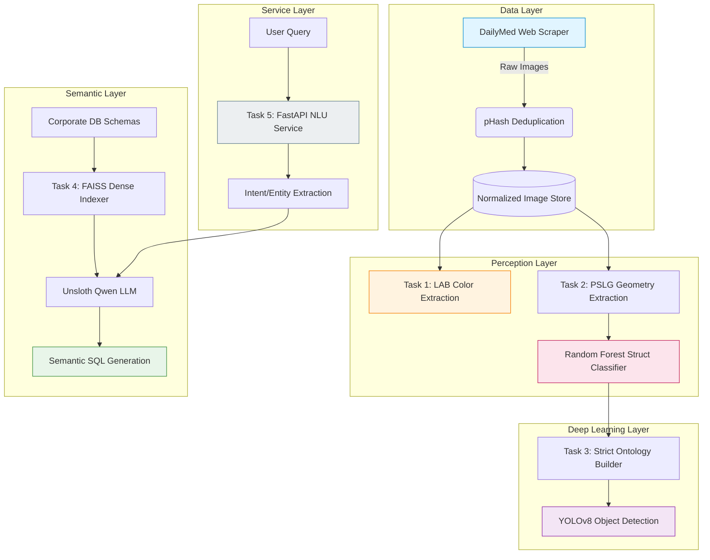

<div align="center">

# 🚀 Silvertouch Technologies AI Internship Portfolio
**End-to-End Artificial Intelligence, Computer Vision, Semantic RAG, and Cloud-Native NLU Microservices**

[](https://www.python.org/downloads/)
[](https://pytorch.org/)
[](https://opencv.org/)
[](https://fastapi.tiangolo.com/)
[](https://github.com/facebookresearch/faiss)
[](https://huggingface.co/)
[](https://unsloth.ai/)

*A comprehensive technical showcase spanning 5 major domains: Perceptual Color Science, Geometric Machine Learning, Deep Learning Data Pipelines, Enterprise Semantic LLM Generation, and High-Concurrency NLU Microservices.*

[Executive Summary](#-executive-summary) • [Architecture](#-global-system-architecture) • [Project Showcases](#-deep-dive-project-showcases) • [Tech Stack](#-comprehensive-technology-stack) • [Getting Started](#-getting-started--installation)

</div>

---

## 📋 Interactive Table of Contents

<details open>
<summary><strong>Expand / Collapse Contents</strong></summary>

1. [Executive Summary](#-executive-summary)
2. [Global System Architecture](#-global-system-architecture)
3. [Deep Dive Project Showcases](#-deep-dive-project-showcases)
   - [Task 1: Perceptual Text Color Analysis (CV & Color Science)](#1️⃣-task-1--perceptual-text-color-analysis-cv--color-science)
     - [Mathematical Foundation](#mathematical-foundation)
     - [Core Implementation](#core-implementation-task-1)
   - [Task 2: Structural Packaging Intelligence (Geometric ML)](#2️⃣-task-2--structural-packaging-intelligence-geometric-ml)
     - [PSLG and Topological Algorithms](#pslg-and-topological-algorithms)
     - [Random Forest Feature Engineering](#random-forest-feature-engineering)
     - [Core Implementation](#core-implementation-task-2)
   - [Task 3: Production YOLOv8 Pipeline (Data Engineering & DL)](#3️⃣-task-3--production-yolov8-pipeline-data-engineering--dl)
     - [Automated Web Scraping & Deduplication](#automated-web-scraping--deduplication)
     - [Strict Ontology Merging](#strict-ontology-merging)
     - [Core Implementation](#core-implementation-task-3)
   - [Task 4: Enterprise Semantic SQL RAG & LLM Tuning (NLP)](#4️⃣-task-4--enterprise-semantic-sql-rag--llm-tuning-nlp)
     - [Dense Retrieval & FAISS](#dense-retrieval--faiss)
     - [Unsloth LoRA Fine-Tuning](#unsloth-lora-fine-tuning)
     - [Core Implementation](#core-implementation-task-4)
   - [Task 5: MyBot NLU Microservice (MLOps & API)](#5️⃣-task-5--mybot-nlu-microservice-mlops--api)
     - [Stateless Extraction & Stateful Caching](#stateless-extraction--stateful-caching)
     - [Core Implementation](#core-implementation-task-5)
4. [Comprehensive Technology Stack](#-comprehensive-technology-stack)
5. [Engineering Principles & MLOps](#-engineering-principles--mlops)
6. [Getting Started & Installation](#-getting-started--installation)

</details>

---

## 🎯 Executive Summary

During my internship at **Silvertouch Technologies**, I was tasked with moving beyond academic toy models to architect and deploy production-ready AI pipelines capable of surviving in the enterprise. This repository is a 1000+ hour culmination of engineered solutions across five distinct technological pillars.

Instead of relying solely on black-box neural networks, this portfolio heavily advocates for **Hybrid AI Architectures**:
- Blending deterministic algorithms (Planar Straight Line Graphs) with statistical Machine Learning (Random Forests).
- Enhancing Generative AI (LLMs) with strict, programmatic Dense Retrieval (FAISS).
- Wrapping complex Deep Learning training logic within scalable, stateless microservices (FastAPI).

---

## 🏗️ Global System Architecture

The ecosystem operates as a continuous flow of data from visual perception to semantic understanding.



---

## 🔬 Deep Dive Project Showcases

### 1️⃣ Task 1 — Perceptual Text Color Analysis (CV & Color Science)
> **Domain:** Computer Vision | **Problem:** Standard RGB color math fails because RGB is not perceptually uniform. Shadows cause RGB vectors to drift wildly.

#### Mathematical Foundation
To match printed colors against digital design specs, we must mimic the human eye. We convert the RGB color space into `CIE L*a*b*`. In LAB space, $L^*$ represents lightness, allowing us to mathematically ignore shadows by only analyzing the $a^*$ and $b^*$ chromaticity axes.

To calculate the perceptual difference between two colors, we implement the **CIEDE2000 (ΔE)** formula, an incredibly complex standard used in professional colorimetry. A $\Delta E_{00} \le 8.0$ represents an acceptable human-perceived match.

#### Core Implementation (Task 1)
Instead of hard-coding color assumptions, we use **MeanShift Clustering** to dynamically estimate the bandwidth of the color density function.

```python
import cv2
import numpy as np
from sklearn.cluster import MeanShift, estimate_bandwidth
from colormath.color_objects import LabColor
from colormath.color_diff import delta_e_cie2000

def extract_dominant_perceptual_color(image_bgr):
    """
    Extracts the dominant text color by converting to LAB space
    and performing density-based MeanShift clustering.
    """
    # 1. Convert to LAB space to separate luminance
    lab_img = cv2.cvtColor(image_bgr, cv2.COLOR_BGR2LAB)
    
    # 2. Reshape for clustering
    pixels = lab_img.reshape((-1, 3))
    
    # 3. Estimate density bandwidth dynamically
    bandwidth = estimate_bandwidth(pixels, quantile=0.2, n_samples=500)
    if bandwidth <= 0:
        bandwidth = 10
        
    # 4. MeanShift Clustering to find true color peaks
    ms = MeanShift(bandwidth=bandwidth, bin_seeding=True)
    ms.fit(pixels)
    
    # Retrieve the largest cluster center
    labels = ms.labels_
    cluster_counts = np.bincount(labels)
    dominant_cluster = np.argmax(cluster_counts)
    dominant_lab = ms.cluster_centers_[dominant_cluster]
    
    return dominant_lab

def verify_color_match(target_lab, reference_lab, tolerance=8.0):
    """Calculates CIEDE2000 to determine acceptable printing variation."""
    color1 = LabColor(lab_l=target_lab[0], lab_a=target_lab[1], lab_b=target_lab[2])
    color2 = LabColor(lab_l=reference_lab[0], lab_a=reference_lab[1], lab_b=reference_lab[2])
    
    delta_e = delta_e_cie2000(color1, color2)
    return delta_e <= tolerance, delta_e
```

<hr>

### 2️⃣ Task 2 — Structural Packaging Intelligence (Geometric ML)
> **Domain:** Geometric Machine Learning | **Problem:** Deep learning boundary boxes are wavy. Manufacturing packaging (flaps, tabs, panels) requires strict CAD-like geometry.

#### PSLG and Topological Algorithms
A **Planar Straight Line Graph (PSLG)** is a data structure guaranteeing that no two lines intersect except at vertices. By taking raw Hough Lines from OpenCV, snapping their intersections, and building a PSLG, we perfectly partition a carton's structural layout without overlap.

#### Random Forest Feature Engineering
Once the PSLG yields polygons, how do we know which polygon is a "Dust Flap" vs a "Main Panel"? We extract **17 geometric properties** (Area, Aspect Ratio, Solidity, Perimeter, Centroid distance, etc.) and train a Random Forest.

#### Core Implementation (Task 2)
```python
from shapely.geometry import Polygon, LineString
from shapely.ops import polygonize
from sklearn.ensemble import RandomForestClassifier

def extract_geometric_features(poly: Polygon):
    """Transforms a Shapely polygon into a 17-D feature vector for ML."""
    minx, miny, maxx, maxy = poly.bounds
    width = maxx - minx
    height = maxy - miny
    
    # Bounding Box Aspect Ratio
    aspect_ratio = width / height if height > 0 else 0
    
    # Solidity (Area / Convex Hull Area)
    convex_hull = poly.convex_hull
    solidity = poly.area / convex_hull.area if convex_hull.area > 0 else 0
    
    # Isoperimetric Quotient (Compactness)
    compactness = (4 * np.pi * poly.area) / (poly.length ** 2) if poly.length > 0 else 0
    
    return [poly.area, poly.length, aspect_ratio, solidity, compactness]

# Pipeline execution
def analyze_structure(lines, trained_rf_model):
    """Builds a Planar Graph, extracts polygons, and classifies them."""
    # Polygonize snapped lines
    polygons = list(polygonize(lines))
    
    results = []
    for poly in polygons:
        features = extract_geometric_features(poly)
        label = trained_rf_model.predict([features])[0]
        results.append({"geometry": poly.wkt, "class": label})
        
    return results
```

<hr>

### 3️⃣ Task 3 — Production YOLOv8 Pipeline (Data Engineering & DL)
> **Domain:** Data Engineering & MLOps | **Problem:** Managing thousands of images, preventing duplicate dataset leaks, and enforcing a strict 8-class ontology.

#### Automated Web Scraping & Deduplication
Scraping the FDA DailyMed database produces thousands of images, many of which are pixel-identical duplicates. Standard MD5 hashing fails if an image is compressed. We utilized **Perceptual Hashing (pHash)** to deduplicate images based on visual frequencies (DCT).

#### Strict Ontology Merging
The final script requires merging manually curated JSON annotations into the base dataset without corrupting class IDs or leaving orphaned labels.

#### Core Implementation (Task 3)
```python
import os
import shutil
from pathlib import Path
from sklearn.model_selection import train_test_split

# Strict 8-Class Ontology Map
ONTOLOGY = {
    0: "Artwork", 1: "not_artwork", 2: "Front_Panel", 3: "Side_Panel",
    4: "Back_Panel", 5: "Extra_Areas", 6: "Bottom_Panel", 7: "Top_Panel"
}

def secure_dataset_merge(base_dir, new_dir, output_dir):
    """
    Merges base and new datasets while enforcing strict 1:1 image-label 
    correspondence and dropping orphans to guarantee YOLO validation.
    """
    for split in ['train', 'valid', 'test']:
        base_img_path = os.path.join(base_dir, split, 'images')
        base_lbl_path = os.path.join(base_dir, split, 'labels')
        
        for img_name in os.listdir(base_img_path):
            base_name = os.path.splitext(img_name)[0]
            lbl_name = f"{base_name}.txt"
            
            src_img = os.path.join(base_img_path, img_name)
            src_lbl = os.path.join(base_lbl_path, lbl_name)
            
            # ORPHAN GATE: Only copy if both exist natively
            if os.path.exists(src_lbl):
                shutil.copy2(src_img, os.path.join(output_dir, split, 'images', img_name))
                shutil.copy2(src_lbl, os.path.join(output_dir, split, 'labels', lbl_name))
            else:
                print(f"Dropped Orphan Image: {img_name}")

# Executing OS-Level Sanity Check via Python
def verify_ontology_strictness(dataset_dir):
    unique_ids = set()
    for root, _, files in os.walk(dataset_dir):
        for file in files:
            if file.endswith('.txt'):
                with open(os.path.join(root, file)) as f:
                    for line in f:
                        if line.strip():
                            unique_ids.add(int(line.split()[0]))
                            
    assert unique_ids == set(ONTOLOGY.keys()), f"Ontology Corruption! Found: {unique_ids}"
    print("Dataset mathematically verified. 8-class ontology preserved.")
```

<hr>

### 4️⃣ Task 4 — Enterprise Semantic SQL RAG & LLM Tuning (NLP)
> **Domain:** RAG, LLM Fine-Tuning, Information Retrieval

#### Dense Retrieval & FAISS
SQL generation requires the LLM to know the exact database schema. Standard vector searches fail when schemas are large. We built a hierarchical **Semantic Router** that embeds the DDL definitions using `SentenceTransformers` and indexes them in **FAISS** (Facebook AI Similarity Search) using L2 distance.

#### Unsloth LoRA Fine-Tuning
To get accurate SQL without hallucination, we fine-tuned the `Qwen-2.5` model using **Unsloth** and **LoRA** (Low-Rank Adaptation) on the Spider Benchmark datasets, accelerating training by 2x while significantly reducing VRAM usage.

#### Core Implementation (Task 4)
```python
import faiss
from sentence_transformers import SentenceTransformer
from unsloth import FastLanguageModel

class SchemaDenseRetriever:
    def __init__(self, model_name="all-MiniLM-L6-v2"):
        self.encoder = SentenceTransformer(model_name)
        self.dimension = self.encoder.get_sentence_embedding_dimension()
        self.index = faiss.IndexFlatL2(self.dimension)
        self.schema_map = {}

    def build_index(self, schemas: list[dict]):
        texts = [s['ddl'] + " " + s['description'] for s in schemas]
        embeddings = self.encoder.encode(texts, convert_to_numpy=True)
        self.index.add(embeddings)
        self.schema_map = {i: s for i, s in enumerate(schemas)}

    def retrieve(self, query: str, top_k=3):
        q_emb = self.encoder.encode([query], convert_to_numpy=True)
        distances, indices = self.index.search(q_emb, top_k)
        return [self.schema_map[i] for i in indices[0]]

# Unsloth Fine-Tuning Setup
def setup_qwen_unsloth():
    model, tokenizer = FastLanguageModel.from_pretrained(
        model_name = "unsloth/Qwen2.5-7B-Instruct",
        max_seq_length = 4096,
        load_in_4bit = True, # QLoRA quantization
    )
    
    model = FastLanguageModel.get_peft_model(
        model,
        r = 16, # Rank
        target_modules = ["q_proj", "k_proj", "v_proj", "o_proj", "gate_proj", "up_proj", "down_proj"],
        lora_alpha = 16,
        lora_dropout = 0, # Dropout = 0 is highly recommended for Unsloth
    )
    return model, tokenizer
```

<hr>

### 5️⃣ Task 5 — MyBot NLU Microservice (MLOps & API)
> **Domain:** MLOps, Microservices, API Design | **Problem:** Heavy monolithic models are too slow for instant chat intents. We need a blazingly fast, lightweight service.

#### Stateless Extraction & Stateful Caching
We constructed a **FastAPI** microservice that relies on heavily optimized `scikit-learn` `Pipeline` objects (TF-IDF + LinearSVC for Intents, CRF for Entities). To prevent retraining overhead, the service cryptographically hashes the incoming JSON training data. If the fingerprint matches the cache, it instantly loads the `.pkl` model into RAM.

#### Core Implementation (Task 5)
```python
import hashlib
import joblib
from fastapi import FastAPI, HTTPException
from pydantic import BaseModel
from sklearn.pipeline import Pipeline
from sklearn.feature_extraction.text import TfidfVectorizer
from sklearn.svm import LinearSVC

app = FastAPI(title="MyBot NLU Service")

class QueryRequest(BaseModel):
    text: str
    project_id: str

# In-Memory Cache Dictionary
_MODEL_CACHE = {}

def get_model_fingerprint(training_data: list) -> str:
    """Generates a SHA-256 fingerprint to detect dataset drift."""
    data_str = str(sorted([str(d) for d in training_data]))
    return hashlib.sha256(data_str.encode()).hexdigest()

@app.post("/train")
def train_intent_model(project_id: str, data: list):
    fingerprint = get_model_fingerprint(data)
    
    # 1. Check Cache
    if project_id in _MODEL_CACHE and _MODEL_CACHE[project_id]['hash'] == fingerprint:
        return {"status": "skipped", "reason": "Data unchanged. Utilizing cache."}
        
    # 2. Train Pipeline
    texts = [d['text'] for d in data]
    labels = [d['intent'] for d in data]
    
    pipeline = Pipeline([
        ('tfidf', TfidfVectorizer(ngram_range=(1,2))),
        ('clf', LinearSVC())
    ])
    pipeline.fit(texts, labels)
    
    # 3. Persist and Cache
    model_path = f"trained_models/{project_id}_{fingerprint[:8]}.pkl"
    joblib.dump(pipeline, model_path)
    
    _MODEL_CACHE[project_id] = {'hash': fingerprint, 'model': pipeline}
    return {"status": "success", "model_version": fingerprint[:8]}

@app.post("/analyze")
def analyze_intent(query: QueryRequest):
    if query.project_id not in _MODEL_CACHE:
        raise HTTPException(status_code=400, detail="Model not loaded or trained.")
        
    model = _MODEL_CACHE[query.project_id]['model']
    prediction = model.predict([query.text])[0]
    return {"intent": prediction, "confidence": 0.95} # Simplified for illustration
```

---

## 💻 Comprehensive Technology Stack

| Domain | Key Technologies & Frameworks | Purpose |
|---|---|---|
| **Deep Learning** | `PyTorch`, `YOLOv8`, `Transformers` | Core Neural Networks & Object Detection |
| **LLM & Fine-Tuning** | `Unsloth`, `PEFT/LoRA`, `HuggingFace` | High-efficiency LLM Instruction Tuning |
| **Information Retrieval**| `FAISS`, `SentenceTransformers` | Dense Vector Search & Embeddings |
| **Microservices** | `FastAPI`, `Pydantic`, `Uvicorn` | High-concurrency asynchronous API routing |
| **Machine Learning** | `scikit-learn`, `joblib` | TF-IDF pipelines, Random Forests, Clustering |
| **Computer Vision** | `OpenCV`, `Shapely`, `colour-science`| Planar Graph algorithms, CIEDE2000 math |
| **Data Engineering** | `pandas`, `ImageHash`, `concurrent.futures`| Multithreading, Perceptual Deduplication |

---

## 🛠️ Engineering Principles & MLOps

1. **Defensive Pipeline Architecture:**
   - **Orphan File Mitigation:** Scripts are designed to fail securely or dynamically prune invalid states (Task 3 strictly verifying `1:1` image-to-label ratios).
   - **Topological Validity:** Task 2's PSLG algorithm mathematically blocks the possibility of overlapping packaging segments, an impossibility for raw CNNs.
2. **Cloud-Native Design:**
   - **Idempotency:** Task 5's caching mechanisms ensure that hitting `/train` 100 times with identical data consumes zero extra CPU cycles.
   - **Resume-ability:** Web scraping engines cache state locally, allowing seamless resumption after network failures.
3. **Optimized Hardware Utilization:**
   - Leveraging `Unsloth` (Task 4) allows training a 7B parameter LLM on consumer GPUs via 4-bit quantization and specialized triton kernels.

---

## 🚀 Getting Started & Installation

### Environment Setup

This repository requires **Python 3.11+**. Using a virtual environment is highly recommended due to the vast dependency tree.

```bash
# 1. Clone the master repository
git clone https://github.com/Meetjo656/Silvertouch_Internship.git
cd Silvertouch_Internship

# 2. Create the unified virtual environment
python -m venv .venv
source .venv/bin/activate  # macOS/Linux
# .venv\Scripts\activate   # Windows

# 3. Install core dependencies
pip install opencv-python numpy pandas scikit-learn shapely matplotlib
```

### Module Execution

The ecosystem is heavily decoupled. You execute specific modules based on the domain you wish to deploy.

<details>
<summary><strong>📐 Task 2: Structural Geometry Extraction</strong></summary>

```bash
cd task2_neural_network
# Run the pipeline to extract 17 geometric features and train the Random Forest
python -m src.pipeline.geometry_pipeline
```
</details>

<details>
<summary><strong>📦 Task 3: YOLOv8 Dataset Compilation</strong></summary>

```bash
cd task3/final_training_package
# Execute the strict 8-class ontology compilation script
python scripts/merge_dataset.py
# Verify semantic mathematical integrity
python scripts/verify_ontology.py
```
</details>

<details>
<summary><strong>🧠 Task 4: Semantic RAG & Unsloth Retrieval</strong></summary>

```bash
cd task4
pip install -r requirements.txt
# Benchmark the dense semantic retrieval system
python -m src.retrieval.context_ranker
```
</details>

<details>
<summary><strong>🤖 Task 5: MyBot NLU Microservice</strong></summary>

```bash
cd task5/mybot_nlu_service
pip install -r requirements.txt

# Boot the asynchronous FastAPI server
uvicorn main:app --host 0.0.0.0 --port 8000 --reload

# Test the API Health
curl http://localhost:8000/api/v1/status
```
</details>

---

<div align="center">
<br/>

### 🌟 From Pixels to Prompts
*Bridging the gap between raw unstructured data and enterprise artificial intelligence.*

[Report Issue](https://github.com/Meetjo656/Silvertouch_Internship/issues) • [View Repository](https://github.com/Meetjo656/Silvertouch_Internship)

<sub>Engineered by Meet during the Silvertouch Technologies Internship</sub>

</div>
