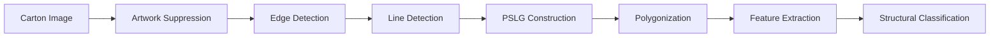

# 🚀 Silvertouch Internship Portfolio

> **Computer Vision, Machine Learning, Data Engineering & Semantic AI** — A comprehensive collection of intelligent systems developed during a technology internship, demonstrating the full AI/ML lifecycle from data collection to semantic decision-making.

<div align="center">


[Explore Projects](#-projects) • [View Architecture](#-architecture-journey) • [Tech Stack](#-technology-stack) • [Skills](#-skills-demonstrated)

</div>

---

## 📌 Quick Navigation

- [Overview](#-overview)
- [Projects](#-projects)
- [Architecture Journey](#-architecture-journey)
- [Repository Structure](#-repository-structure)
- [Technology Stack](#-technology-stack)
- [Skills Demonstrated](#-skills-demonstrated)
- [Deliverables](#-deliverables)
- [Getting Started](#-getting-started)

---

## 🎯 Overview

This repository showcases a collection of **integrated AI and software engineering projects** developed during an internship at Silvertouch Technologies. The work spans multiple domains and demonstrates how to architect, build, and deploy intelligent systems at scale.

### Problem Space

The internship tackled challenges across the AI/ML lifecycle:

1. **Perception & Understanding** — How do you teach machines to see and understand visual information like humans do?
2. **Geometry & Structure** — How can you recover hidden structure from visual data?
3. **Data Intelligence** — How do you build reliable, scalable pipelines to collect and prepare data?
4. **Semantic Understanding** — How do you enable non-technical users to query complex systems through natural language?

### Solution Approach

Rather than solving each problem independently, the projects build upon each other, demonstrating how modern AI systems integrate multiple technologies into cohesive platforms.

---

## 🎨 Projects

### Project Showcase

| # | Project | Domain | Status | Key Tech |
|---|---------|--------|--------|----------|
| 1️⃣ | **Perceptual Text Color Analysis** | Computer Vision | ✅ Complete | LAB Color Space, ΔE CIE2000, MeanShift |
| 2️⃣ | **Structural Packaging Intelligence** | Computer Vision + ML | ✅ Complete | Geometry, Random Forest, Polygonization |
| 3️⃣ | **Dataset Engineering Pipeline** | Data Engineering | ✅ Complete | Web Scraping, Deduplication, COCO Format |
| 4️⃣ | **Semantic SQL Generation** | NLP + LLMs | ✅ Complete | Transformers, RAG, Entity Extraction |

---

## 📊 Project Details

<details>
<summary><strong>Task 1: Perceptual Text Color Analysis</strong> — Determine if printed text colors match human perception</summary>

### Problem

Pharmaceutical packaging quality assurance requires verifying that printed text colors match design specifications. However, raw RGB values don't capture how humans perceive color differences.

### Solution

A perception-aware comparison pipeline using:
- **Foreground extraction** via color distance in LAB space
- **MeanShift clustering** to identify dominant ink colors
- **ΔE CIE2000** metric for perceptual color difference measurement
- **Visual dashboards** showing comparison results

### Pipeline

```
Image 1          Image 2
  ↓                ↓
Extract Foreground (LAB)
  ↓
MeanShift Clustering
  ↓
Dominant Color Detection
  ↓
ΔE Comparison (Threshold: 8.0)
  ↓
Dashboard Visualization
```

### Key Metrics

| Metric | Target | Result |
|--------|--------|--------|
| ΔE Threshold | ≤ 8.0 | ✅ PASS |
| Foreground Detection | Accurate | ✅ PASS |
| Color Family Classification | High Precision | ✅ PASS |

### Technologies

- **OpenCV** — Image I/O and preprocessing
- **NumPy** — Numerical operations
- **scikit-learn** — MeanShift clustering
- **colour-science** — CIE LAB and ΔE calculations
- **Matplotlib** — Visualization

### Output

`comparison_dashboard.png` — Side-by-side analysis with masks, clusters, swatches, and ΔE metrics

### Skills Demonstrated

`Color Science` • `Perception` • `Clustering` • `Image Analysis` • `Visualization`

</details>

<details>
<summary><strong>Task 2: Structural Packaging Intelligence</strong> — Recover physical carton structure from images</summary>

### Problem

Pharmaceutical cartons contain more than artwork. Their physical structure is defined by panels, fold lines, dust flaps, and glue tabs that determine how the package is manufactured and assembled.

Manually identifying these structural elements is time-consuming and difficult to scale across large packaging datasets.

### Solution

A geometry-first computer vision pipeline designed to reconstruct carton structure directly from images.

The system:

* Removes artwork and visual noise
* Detects structural boundaries and fold lines
* Constructs planar geometric representations
* Generates closed structural regions
* Extracts geometric features from recovered regions
* Classifies structural components using machine learning

### Workflow



### Key Capabilities

| Capability                   | Description                                              |
| ---------------------------- | -------------------------------------------------------- |
| Structural Boundary Recovery | Detects carton outlines and fold structures              |
| Planar Partition Generation  | Converts line networks into closed geometric regions     |
| Geometric Feature Extraction | Produces shape-based descriptors for classification      |
| Structural Classification    | Identifies panels, flaps, and tabs                       |
| Quality Auditing             | Validates topology, connectivity, and region consistency |

### Geometric Features (17-Dimensional Profile)

**Basic Properties:** Area, perimeter, relative area  
**Bounding Attributes:** Width, height, aspect ratio  
**Topological Complexity:** Solidity, extent, vertex count  
**Circular Properties:** Equivalent diameter, circularity  
**Rotation-Invariant:** Rotated dimensions, minimum area rectangle  
**Spatial Centroids:** X/Y coordinates

### Classification Results

| Metric | Result |
|--------|--------|
| Geometric Coverage | High accuracy on structured regions |
| Component Classification | Validated via topology |
| Boundary Extraction | GeoJSON-compliant output |

### Technologies

* **OpenCV** — Edge and image processing
* **Shapely** — Geometric operations and polygon handling
* **NumPy** — Numerical computation
* **scikit-learn** — Random Forest classification
* **GeoJSON** — Structural representation and export

### Outputs

* Structural overlays and visual reports
* Polygon and region definitions
* GeoJSON partition data
* Classification predictions
* Topology validation reports

### Skills Demonstrated

`Computer Vision` • `Geometric Reasoning` • `Feature Engineering` • `Machine Learning` • `Spatial Analysis` • `Pipeline Design`

</details>

<details>
<summary><strong>Task 3: Dataset Engineering Pipeline</strong> — Automated data collection, cleaning, and preparation</summary>

### Problem

Machine learning systems depend on high-quality datasets. Manual collection and preparation is time-consuming and error-prone. Scalable, reproducible data pipelines are essential.

### Solution

A comprehensive data engineering platform combining:
- **Web scraping** of pharmaceutical packaging sources at scale
- **Perceptual deduplication** using image hashing
- **Filtering** to remove irrelevant assets (thumbnails, UI elements)
- **Normalization** to standardized dimensions
- **Annotation mapping** to unified formats (COCO)
- **Dataset splitting** for training/validation/evaluation

### Data Pipeline

```
Raw Sources (DailyMed, Roboflow)
  ↓
Download Images (Multi-threaded)
  ↓
Perceptual Hashing & Deduplication
  ↓
Quality Filtering (Size, Aspect Ratio, Content)
  ↓
Resolution Normalization (Max 1000px, Lanczos)
  ↓
COCO Annotation Mapping & Alignment
  ↓
Dataset Splits (Train/Test/Validation)
  ↓
Unified Output Datasets
```

### Processing Features

| Feature | Implementation |
|---------|-----------------|
| Multi-threaded Downloads | Rapid parallel ingestion |
| Deduplication | Perceptual image hashing (phash) |
| Quality Filters | Aspect ratio, size, content validation |
| Session Resumption | Tracking for seamless restarts |
| Annotation Mapping | Unified category labels across sources |

### COCO Category Mapping

| ID | Label |
|----|-------|
| 1-2 | Artwork Classification |
| 3-8 | Structural Components (Panels, Flaps) |

### Dataset Outputs

| Split | Contents | Status |
|-------|----------|--------|
| `train/` | Training set with annotations | ✅ Ready |
| `test/` | Test set with annotations | ✅ Ready |
| `valid/` | Validation set with annotations | ✅ Ready |
| `Scrapped/output/` | DailyMed artwork cache | ✅ Complete |

### Technologies

- **Python requests** — HTTP downloads
- **PIL/Pillow** — Image processing and resizing
- **ImageHash** — Perceptual deduplication
- **pandas** — Data manipulation
- **Multi-threading** — Parallel processing

### Deliverables

- Deduplicated image corpus
- Standardized COCO annotations
- Metadata tracking (URLs, hashes, sizes)
- Reproducible ingestion logs

### Skills Demonstrated

`Web Scraping` • `Data Cleaning` • `Pipeline Automation` • `Deduplication` • `Scale Engineering` • `Quality Assurance`

</details>

<details>
<summary><strong>Task 4: Semantic SQL Generation & Entity Extraction</strong> — Natural language to database queries via LLMs</summary>

### Problem

Business users know what information they need but often don't know SQL. Creating user-friendly interfaces to complex databases requires bridging natural language and database queries.

### Solution

An intelligent query understanding system combining:
- **Semantic routing** to classify user intent and extract entities
- **Multi-source context retrieval** (DDL, documentation, similar SQL examples)
- **Relevance ranking** to assemble optimal prompts
- **Fine-tuned LLMs** (Transformers + PEFT/LoRA) to generate SQL
- **Entity extraction** with semantic validation

### Architecture

```
User Query + Context
  ↓
Semantic Intent Classification
  ├─→ Extract Entities (State, District, Sector)
  ├─→ Classify Intent (Statistics, Drill-down, Hierarchy)
  └─→ Route to Retrieval Pipeline
  ↓
Multi-Source Context Retrieval
  ├─→ DDL Retriever (Schema definitions)
  ├─→ Doc Retriever (Documentation snippets)
  ├─→ SQL Retriever (Similar examples)
  └─→ Embedding Retriever (FAISS semantic search)
  ↓
Context Ranking & Assembly
  ├─→ Relevance scoring (BM25 + embeddings)
  ├─→ Multi-source combination
  └─→ Final prompt construction
  ↓
LLM Inference
  ├─→ Fine-tuned Model (PEFT/LoRA)
  └─→ Generate SQL with explanation
  ↓
Output Assembly
  └─→ SQL + Confidence + Entities + Metadata
```

### Core Components

| Component | Purpose | Technology |
|-----------|---------|------------|
| **Semantic Router** | Intent & entity classification | Embeddings + ML |
| **DDL Retriever** | Schema information | Database introspection |
| **Doc Retriever** | Documentation search | BM25 + semantic search |
| **SQL Retriever** | Similar query examples | Lexical + semantic matching |
| **Context Ranker** | Multi-source aggregation | Relevance scoring |
| **LLM Inference** | Query generation | Transformers + PEFT |
| **Entity Extractor** | Semantic entity recognition | Regex + ML classification |
| **Evaluator** | Quality metrics | EM, F1, BLEU, MRR, NDCG |

### Semantic Catalog

Unified enterprise ontology defining:
- **Concept definitions** (State, District, Sector)
- **Aliases and variations**
- **Module mappings** (which business module owns each concept)
- **Related tables & columns**
- **Parent/child hierarchies**
- **Confidence scores**

Example:
```json
{
  "concept": "State",
  "definition": "Primary administrative division",
  "modules": ["GP_COVERAGE", "COOPERATIVE"],
  "related_tables": ["locations", "districts"],
  "confidence": 0.99
}
```

### Evaluation Metrics

| Metric | Purpose |
|--------|---------|
| **EM** (Exact Match) | Correct SQL matches exactly |
| **F1** (Partial Match) | Token-level overlap |
| **BLEU** | N-gram similarity |
| **MRR** | Retrieval ranking quality |
| **NDCG** | Context relevance ranking |
| **Entity F1** | Entity extraction precision/recall |

### Technologies

- **Transformers** — Pre-trained LLM backbone
- **PEFT/LoRA** — Efficient fine-tuning
- **FAISS** — Vector similarity search
- **Sentence Transformers** — Semantic embeddings
- **SQLAlchemy** — Query validation
- **FastAPI** — Production API deployment
- **scikit-learn** — ML components (routing, extraction)

### Example Usage

```python
# Initialize components
router = SemanticRouter()
retriever = ContextRetriever()
model = LLMInference()

# Process query
query = "Show state-wise dairy cooperative statistics"
context = UserContext(state="Maharashtra", role="analyst")

# Route and extract
routing = router.route(query, context)  # Intent + entities
context_results = retriever.retrieve(routing['entities'])  # Multi-source
prompt = assemble_prompt(query, context_results)

# Generate SQL
sql = model.generate(prompt)
```

### Deliverables

- Fine-tuned model weights (PEFT/LoRA)
- FAISS embedding indices
- Semantic catalog (JSON)
- Evaluation reports with metrics
- Production-ready inference API

### Skills Demonstrated

`NLP` • `LLM Fine-tuning` • `Semantic Search` • `Entity Extraction` • `Information Retrieval` • `RAG Systems` • `API Design`

</details>

---

## 🏗️ Architecture Journey

The projects form an integrated AI/ML lifecycle:


### The AI/ML Lifecycle in Practice

| Stage | Task | Input | Output | Technology |
|-------|------|-------|--------|-----------|
| **1. Data** | Scraping + Cleaning | Raw web content | Curated datasets | Web scraping, deduplication |
| **2. Understanding** | Computer Vision | Images | Features, segments | OpenCV, geometry |
| **3. Learning** | ML Classification | Features + labels | Trained models | scikit-learn, RF |
| **4. Intelligence** | Semantic AI | Natural language | Structured queries | Transformers, retrieval |
| **5. Action** | Decision Support | Queries + results | Insights & automation | LLMs, APIs |

---

## 📁 Repository Structure

```
Silvertouch_Internship/
│
├── task1/                          # 🎨 Perceptual Text Color Analysis
│   ├── main.py                     # Entry point
│   ├── config.py                   # Configuration & thresholds
│   ├── data/                       # Reference & target images
│   ├── outputs/                    # Comparison dashboards
│   ├── preprocessing/              # Image loading & foreground extraction
│   ├── clustering/                 # MeanShift color clustering
│   ├── color_processing/           # LAB space, ΔE, color families
│   └── visualization/              # Dashboard rendering
│
├── task2_neural_network/           # 🏭 Structural Packaging Intelligence
│   ├── generate_and_ingest.py      # Data preparation pipeline
│   ├── analyze_masks.py            # Coverage statistics
│   ├── config/                     # Configuration files
│   ├── data/                       # Raw, interim, processed datasets
│   ├── models/                     # Trained Random Forest models
│   ├── src/
│   │   ├── geometry/               # Edge, line, PSLG, polygonization
│   │   ├── features/               # Geometric feature extraction
│   │   ├── models/                 # RF classifier wrapper
│   │   ├── training/               # Model training & evaluation
│   │   ├── pipeline/               # Orchestration pipelines
│   │   ├── blueprint/              # Boundary filtering & validation
│   │   ├── analysis/               # Structural auditing
│   │   ├── core/                   # Shared data structures
│   │   └── utils/                  # Helpers & logging
│   └── tests/                      # Unit tests
│
├── task3/                          # 📥 Dataset Engineering Pipeline
│   ├── train/                      # Training split
│   ├── test/                       # Test split
│   ├── valid/                      # Validation split
│   ├── Scrapped/                   # DailyMed scraper
│   │   ├── src/
│   │   │   ├── main.py             # Scraper entry point
│   │   │   ├── crawler.py          # URL extraction
│   │   │   ├── downloader.py       # Multi-threaded downloads
│   │   │   ├── filters.py          # Quality filtering
│   │   │   └── utils.py            # Deduplication
│   │   └── output/                 # Downloaded images & metadata
│   ├── resize_dataset.py           # Resolution normalization
│   ├── migrate_test.py             # COCO annotation mapping
│   ├── migrate_valid.py            # Validation set mapping
│   └── combine_eval.py             # Dataset split merging
│
├── task4/                          # 🧠 Semantic SQL Generation
│   ├── data/
│   │   ├── raw/                    # Raw SQL/DDL/docs
│   │   ├── processed/              # Fine-tuning JSONL
│   │   ├── embeddings/             # FAISS indices
│   │   ├── semantic_catalog/       # Entity definitions
│   │   └── benchmark/              # Test queries
│   ├── src/
│   │   ├── context/                # User context dataclass
│   │   ├── data_pipeline/          # Dataset building
│   │   ├── ingestion/              # Corpus & profiling
│   │   ├── retrieval/              # Multi-source retrievers
│   │   ├── routing/                # Intent & entity classification
│   │   ├── evaluation/             # Metrics & benchmarking
│   │   └── utils/                  # File ops & reporting
│   ├── scripts/                    # Analysis & utility scripts
│   ├── tests/                      # Unit & integration tests
│   └── requirements.txt            # LLM & NLP dependencies
│
├── src/                            # 🔧 Shared Utilities
│   └── visualization/              # Cross-task visualization helpers
│
└── README.md                       # 📖 This file
```

<details>
<summary><strong>View Detailed Module Breakdown</strong></summary>

### Task 1 Modules

| Module | Classes/Functions | Purpose |
|--------|-------------------|---------|
| `preprocessing/` | `load_image()`, `extract_foreground()`, `estimate_background()` | Image I/O and foreground isolation |
| `clustering/` | `MeanShiftExtractor` | Density-based color clustering |
| `color_processing/` | `CompareColors`, `get_dominant_color()`, `get_color_family()`, `rgb_to_hex()` | Color operations & comparisons |
| `visualization/` | `generate_comparison_dashboard()` | Multi-panel result rendering |

### Task 2 Modules

| Module | Classes/Functions | Purpose |
|--------|-------------------|---------|
| `geometry/` | `EdgeDetector`, `LineDetector`, `PSLGBuilder`, `Polygonizer` | Structural boundary recovery |
| `features/` | `extract_geometric_features()` | 17-dimensional geometric profiles |
| `models/` | `StructuralMaskRFClassifier` | Random Forest wrapper |
| `blueprint/` | `ContainmentFilter`, `TinyFaceFilter`, `StructuralRegionMerger` | Boundary filtering & consolidation |
| `training/` | `train_model()` | Model training & validation |

### Task 4 Modules

| Module | Classes/Functions | Purpose |
|--------|-------------------|---------|
| `routing/` | `SemanticRouter`, `EntityExtractor` | Intent & entity classification |
| `retrieval/` | `DDLRetriever`, `DocRetriever`, `SQLRetriever`, `EmbeddingRetriever`, `ContextRanker` | Multi-source context assembly |
| `evaluation/` | `Evaluator`, Router/Retriever benchmarks | Metrics & quality analysis |
| `data_pipeline/` | `build_dataset()` | Training data preparation |

</details>

---

## 🛠️ Technology Stack

### Computer Vision & Image Processing

| Technology | Usage |
|------------|-------|
| **OpenCV** | Edge detection, line detection, filtering, image I/O |
| **PIL/Pillow** | Image resizing, format conversion |
| **scikit-image** | Advanced morphological operations |
| **NumPy** | Numerical array operations |

### Color Science & Perception

| Technology | Usage |
|------------|-------|
| **colour-science** | CIE LAB color space, ΔE CIE2000 calculations |
| **scikit-learn** | MeanShift clustering for dominant colors |

### Geometry & Spatial Processing

| Technology | Usage |
|------------|-------|
| **Shapely** | Polygon operations, geometric reasoning |
| **Matplotlib/seaborn** | Visualization & plotting |

### Machine Learning & Classification

| Technology | Usage |
|------------|-------|
| **scikit-learn** | Random Forest classification, feature processing |
| **pandas** | Data manipulation and analysis |

### NLP & Large Language Models

| Technology | Usage |
|------------|-------|
| **Transformers** | Pre-trained LLM backbone, semantic embeddings |
| **PEFT** | Parameter-efficient fine-tuning (LoRA) |
| **FAISS** | Vector similarity search & indexing |
| **Sentence Transformers** | Semantic embedding generation |
| **SQLAlchemy** | SQL parsing and validation |

### Data Engineering

| Technology | Usage |
|------------|-------|
| **requests** | HTTP downloads for web scraping |
| **ImageHash** | Perceptual image deduplication |
| **Multi-threading** | Parallel processing for scalability |

### Development & Deployment

| Technology | Usage |
|------------|-------|
| **FastAPI** | Production API servers |
| **pytest** | Unit and integration testing |
| **joblib** | Model serialization |

---

## 🎓 Skills Demonstrated

### Computer Vision & Image Processing

✅ Foreground/background separation  
✅ Edge and boundary detection  
✅ Line detection & regularization  
✅ Polygon extraction & validation  
✅ Image filtering & morphological operations  
✅ Perceptual color science  

### Machine Learning & Feature Engineering

✅ Unsupervised clustering (MeanShift)  
✅ Supervised classification (Random Forest)  
✅ Feature engineering & extraction  
✅ Cross-validation strategies (GroupShuffleSplit)  
✅ Model evaluation & benchmarking  
✅ Handling class imbalance  

### Natural Language Processing & LLMs

✅ Semantic intent classification  
✅ Entity extraction & recognition  
✅ Retrieval-augmented generation (RAG)  
✅ Semantic search (FAISS)  
✅ Fine-tuning with PEFT/LoRA  
✅ Context ranking & assembly  

### Data Engineering & Pipeline Development

✅ Web scraping at scale  
✅ Data cleaning & deduplication  
✅ Annotation format conversion  
✅ Multi-threaded processing  
✅ Reproducible data pipelines  
✅ Dataset versioning & tracking  

### Software Engineering & Architecture

✅ Modular system design  
✅ Component abstraction & inheritance  
✅ Configuration management  
✅ Error handling & validation  
✅ Unit testing  
✅ Documentation & logging  
✅ API design (FastAPI)  

---

## 📦 Deliverables

### Task 1 Outputs

| Artifact | Format | Description |
|----------|--------|-------------|
| `comparison_dashboard.png` | PNG | Visual comparison with metrics |

### Task 2 Outputs

| Artifact | Format | Description |
|----------|--------|-------------|
| `overlay.png` | PNG | Colored region overlay |
| `segment_map.png` | PNG | False-color segmentation |
| `segments.json` | JSON | Labeled components & bboxes |
| `report.json` | JSON | Structural metrics |
| Trained Models | `.joblib` | Random Forest classifiers |

### Task 3 Outputs

| Artifact | Format | Description |
|----------|--------|-------------|
| `train/`, `test/`, `valid/` | Directories | Standardized dataset splits |
| `images.csv` | CSV | Metadata (URL, size, hash) |
| `duplicates.csv` | CSV | Deduplication tracking |
| `images/` | Directory | Downloaded artwork cache |

### Task 4 Outputs

| Artifact | Format | Description |
|----------|--------|-------------|
| `train.jsonl` | JSONL | Fine-tuning dataset |
| `faiss_index.bin` | Binary | Semantic search index |
| `lora_adapter.safetensors` | Weights | Fine-tuned model adapter |
| `eval_report.json` | JSON | Metrics (EM, F1, MRR, NDCG) |
| `quality_report.json` | JSON | SQL error analysis |

---

## 🚀 Getting Started

### Prerequisites

- **Python 3.11+**
- **Virtual environment** (venv or conda)
- **Git**

### Installation

```bash
# Clone repository
git clone https://github.com/Meetjo656/Silvertouch_Internship.git
cd Silvertouch_Internship

# Create virtual environment
python -m venv .venv
source .venv/bin/activate  # macOS/Linux
# .venv\Scripts\activate   # Windows

# Install base dependencies
pip install opencv-python numpy scikit-learn colour-science scikit-image pandas shapely matplotlib seaborn joblib imagehash

# Install task-specific dependencies
pip install -r task2_neural_network/requirements.txt
pip install -r task3/Scrapped/requirements.txt
pip install -r task4/requirements.txt
```

### Running Tasks

<details>
<summary><strong>Task 1: Text Color Comparison</strong></summary>

```bash
cd task1
python main.py
```

**Expected output:** `outputs/comparison_dashboard.png`

</details>

<details>
<summary><strong>Task 2: Structural Analysis</strong></summary>

```bash
cd task2_neural_network

# Analyze masks
python analyze_masks.py

# Train classifier
python -m src.training.train --project_root . --n_estimators 500

# Run pipelines
python -m src.pipeline.geometry_pipeline
python -m src.pipeline.phase_7b_lite_pipeline
```

**Expected outputs:** GeoJSON boundaries, segment maps, trained models

</details>

<details>
<summary><strong>Task 3: Dataset Pipeline</strong></summary>

```bash
cd task3

# Run DailyMed scraper
python Scrapped/src/main.py

# Normalize dataset
python resize_dataset.py

# Map annotations
python migrate_test.py
python migrate_valid.py
python combine_eval.py
```

**Expected outputs:** Standardized train/test/valid splits with COCO annotations

</details>

<details>
<summary><strong>Task 4: Semantic SQL Generation</strong></summary>

```bash
cd task4

# Prepare data
python -m src.data_pipeline.build_dataset
python scripts/analyze_dataset.py

# Build embeddings
python -m src.routing.build_module_embeddings

# Fine-tune model
python -m src.training.train --model_name "meta-llama/Llama-2-7b" --num_epochs 3

# Evaluate
python -m src.evaluation.evaluate_routers
python -m src.evaluation.evaluate_context_ranking

# Run inference
python -m src.pipeline.inference --query "Your natural language query here"
```

**Expected outputs:** Trained model, embeddings, evaluation metrics

</details>

---

## 💡 Key Engineering Principles

### 1. Data-Centric Approach

Every project prioritizes data quality and pipeline reproducibility over quick results.

### 2. Modular Architecture

Systems are decomposed into reusable, independently testable components that can evolve independently.

### 3. Explainability

All systems produce intermediate artifacts and visualizations, avoiding black-box predictions.

### 4. Scalability

Pipelines are designed to handle growing datasets and complexity without architectural rewrites.

### 5. Engineering First

Code quality, testing, documentation, and maintainability are treated as features, not afterthoughts.

---

## 🔮 Future Enhancements

- [ ] Deep learning-based segmentation models (YOLO, Mask R-CNN)
- [ ] Multi-modal systems (vision + language models)
- [ ] Real-time inference optimization (ONNX, TensorRT)
- [ ] Production deployment pipelines (Docker, Kubernetes)
- [ ] Advanced retrieval systems (hypothetical documents, graph-based)
- [ ] Federated learning for privacy-preserving training
- [ ] Interactive web interfaces for end-users
- [ ] Continuous evaluation & monitoring frameworks

---

## 📚 Documentation

Each task contains comprehensive documentation:

- `task1/` — Color analysis pipeline
- `task2_neural_network/` — Structural intelligence system
- `task3/Scrapped/README.md` — Data scraper documentation
- `task4/` — LLM system architecture

---

## 📜 License

This project was developed as part of a professional internship at Silvertouch Technologies. Refer to repository guidelines for usage terms.

---

## 👤 Author

Developed during a technology internship at **Silvertouch Technologies**, focusing on practical applications of computer vision, machine learning, data engineering, and semantic AI.

---

<div align="center">

### 🌟 From Data to Intelligence

**Data Collection** → **Dataset Preparation** → **Computer Vision** → **Machine Learning** → **Semantic AI** → **Decision Support**

Built with 🐍 Python | 🎥 OpenCV | 🔢 NumPy | 🤖 Transformers | 📐 Shapely | 🧠 FAISS

[Report Issue](https://github.com/Meetjo656/Silvertouch_Internship/issues) • [View Project](https://github.com/Meetjo656/Silvertouch_Internship)

</div>
