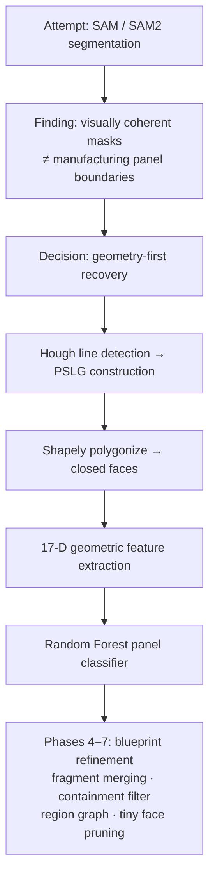
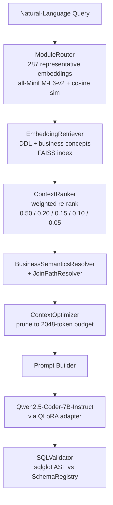
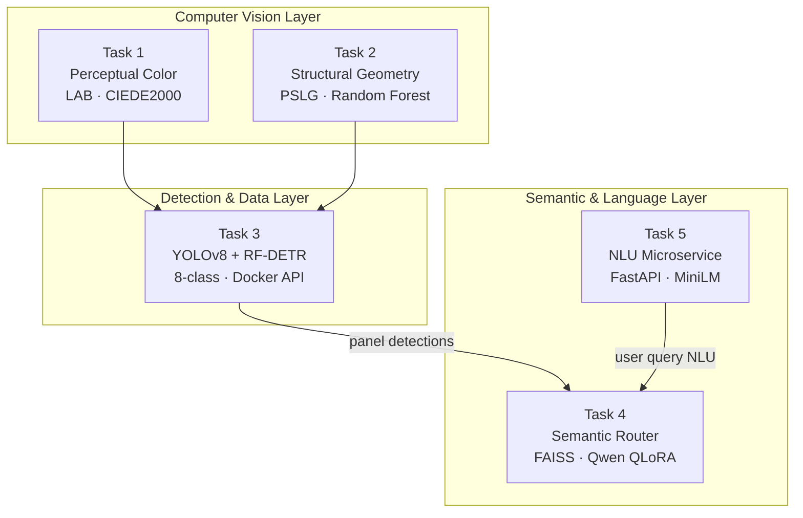

```
meet@silvertouch:~$ portfolio --open
```

<div align="center">

```
╭────────────────────────────────────────────────────────────────────╮
│                                                                    │
│   SILVERTOUCH AI INTERNSHIP                                        │
│   Applied CV · Semantic RAG · NLU Microservices                    │
│                                                                    │
│   5 engineering projects  ·  26 May – 09 July 2026                │
│   R&D Internship @ Silvertouch Technologies Ltd.                   │
│                                                                    │
╰────────────────────────────────────────────────────────────────────╯
```

[](https://www.python.org/)
[](https://pytorch.org/)
[](https://fastapi.tiangolo.com/)
[](https://ultralytics.com/)
[](https://unsloth.ai/)
[](https://docker.com/)

</div>

---

## `$ whoami`

**Meet Joshi** — AI/ML engineering intern at Silvertouch Technologies.

Five projects across perceptual computer vision, geometric ML, object detection, semantic RAG, and NLU microservices. The work runs from low-level color science through LLM fine-tuning — each system replacing a brittle heuristic with a grounded representation.

---

## `$ ls projects/`

```
01  task1/                Perceptual Color Intelligence       [COMPLETE]
02  task2_neural_network/ Carton Structural Intelligence      [RESEARCH]
03  task3/                Detection & Dataset Engineering     [FUNCTIONAL]
04  task4/                Semantic RAG · Text-to-SQL          [PROTOTYPE]
05  task5/                NLU Microservice                    [DEPLOYED]
```

---

## `$ inspect --all`

<details>
<summary><strong>01 · open task-01 — Perceptual Color Intelligence</strong></summary>

&nbsp;

```
┌─ TASK 01 / PERCEPTUAL COLOR ──────────────────────────────────────┐
│ Domain  Computer Vision · Color Science                           │
│ Folder  task1/                                                    │
│ Status  COMPLETE — single-shot CLI, runnable                      │
└───────────────────────────────────────────────────────────────────┘
```

### Problem

Quality-assurance for pharmaceutical packaging artwork requires comparing the text color between a reference design and a production print. Standard RGB distance fails — shadows shift RGB vectors even when the perceived hue is identical.

### Engineering Approach

Convert to **CIE L\*a\*b\*** space. LAB decouples lightness (`L*`) from chromaticity (`a*`, `b*`), so shadow-induced luminance shift does not invalidate a hue comparison. Score inter-image color difference with **CIEDE2000 ΔE**, the professional colorimetry standard. A ΔE₀₀ ≤ 8.0 constitutes an acceptable human-perceived match.

**Pipeline:**

```
Reference + Target images
       │
       ▼
 Background estimation (median of border pixels)
       │
       ▼
 Foreground mask  (CIE 1976 ΔE vs background)
       │
       ▼
 MeanShift clustering in LAB space
   estimate_bandwidth(quantile=0.2)
   No preset cluster count required
       │
       ▼
 Dominant color = max(pixel_count × mean_ΔE_from_background)
       │
       ▼
 CIEDE2000 match decision (threshold 8.0)
 Nearest color family via 949-color XKCD palette
       │
       ▼
 3×4 matplotlib comparison dashboard
```

### Key Decisions

| Decision | Rationale |
|---|---|
| LAB over RGB | Perceptual uniformity — chromaticity axes are shadow-invariant |
| MeanShift over K-Means | No preset cluster count; converges on true color density peaks |
| CIEDE2000 for match | Professional standard used in print QA; more accurate than CIE 1976 |
| CIE 1976 for masking | Per-pixel speed trade-off; CIEDE2000 used only at the decision point |

### Stack

`colour-science` · `opencv-python` · `scikit-learn` · `scikit-image` · `matplotlib`

**→ [`task1/`](task1/) · [`task1_report.md`](task1_report.md)**

</details>

---

<details>
<summary><strong>02 · open task-02 — Carton Structural Intelligence</strong></summary>

&nbsp;

```
┌─ TASK 02 / STRUCTURAL GEOMETRY ───────────────────────────────────┐
│ Domain  Geometric ML · Computer Vision                            │
│ Folder  task2_neural_network/                                     │
│ Status  RESEARCH — 7-phase pipeline, active iteration             │
└───────────────────────────────────────────────────────────────────┘
```

### Problem

Manufacturing packaging requires non-overlapping, CAD-accurate panel boundaries (flaps, dust flaps, glue tabs, main panels). Pixel-wise detectors produce wavy bounding boxes — they cannot guarantee topological correctness or that regions tile without overlap.

### Experimentation

The core research question: **can a geometry-first pipeline recover manufacturing structure that semantic segmentation cannot reliably produce?**



### Architecture

**PSLG (Planar Straight Line Graph):** Hough lines are extended, unioned via `shapely.unary_union` (auto-nodes intersections), and pruned. The graph mathematically prevents overlapping edges — segments can only share vertices, not interiors.

**17-D geometric feature vector per polygon:**
`area · relative_area · perimeter · bbox_width · bbox_height · aspect_ratio · solidity · extent · equiv_diameter · circularity · rotated_width/height/aspect_ratio/area · vertex_count · centroid_x/y`

**Structural classes:** `PANEL · FLAP · GLUE_TAB · DUST_FLAP · BACKGROUND · UNKNOWN`

**Random Forest:** `n_estimators=500, class_weight="balanced"`, StandardScaler. Two trained artifacts: binary structural/non-structural baseline + multiclass component classifier.

**Pipeline phases:**

```
Phase 0  Artwork suppression
Phase 1  Edge detection (Canny)
Phase 2  Hough line detection (HoughLinesP)
Phase 3  Line regularization + PSLG construction
Phase 4  Polygonize → planar partition
Phase 5  Fragment merging
Phase 6  Containment filtering + tiny face pruning
Phase 7  Region graph → blueprint output
```

**Data:** 7 raw images, 371 masks, 186 interim analysis files, 7 blueprint JPEGs.

> Depends on an external SAM weights file for mask ingestion. Research pipeline — not a frozen release.

### Stack

`opencv-python` · `shapely` · `scikit-learn` · `pydantic` · `numpy` · `matplotlib`

**→ [`task2_neural_network/`](task2_neural_network/) · [`task2_report.md`](task2_report.md)**

</details>

---

<details>
<summary><strong>03 · open task-03 — Detection & Dataset Engineering</strong></summary>

&nbsp;

```
┌─ TASK 03 / OBJECT DETECTION ──────────────────────────────────────┐
│ Domain  Computer Vision · Data Engineering · MLOps                │
│ Folder  task3/                                                    │
│ Status  FUNCTIONAL — Docker inference API deployable              │
└───────────────────────────────────────────────────────────────────┘
```

### Problem

Building a reliable detector for pharmaceutical carton panels requires both a clean dataset (no label leakage, strict class integrity) and completeness guarantees — a missed panel cannot silently propagate to downstream OCR/Rx pipelines.

### Pipeline

```
Raw carton images
       │
       ▼
  COCO ↔ YOLO conversion
  + negative-sample injection
       │
       ▼
  Bbox-aware augmentation
  (grayscale · rot180 · rot90cw/ccw · pad-shift)
       │
       ▼
  Deterministic 70/20/10 split
  keyed by original image ID, seed=42
  (prevents augmented variants leaking across folds)
       │
       ├──────────────────────────────────────┐
       ▼                                      ▼
  YOLOv8 (imgsz 512)               RF-DETR Nano/Small (imgsz 640)
  Flask inference API                      blind evaluation
       │
       ▼
  PanelGraph construction
       │
       ▼
  Structural Completion Engine
  Canny + Hough geometry recovery
  Iterative missing-panel assignment (max 3 loops)
  Layout rules + size/edge/distance scoring
  source=geometry_reasoner panels injected
       │
       ▼
  SanityChecker + FailureReporter (JSONL)
  Hard-example mining → re-annotation
```

### 8-Class Ontology

`Artwork · not_artwork · Front_Panel · Side_Panel · Back_Panel · Extra_Areas · Bottom_Panel · Top_Panel`

### Inference API (Docker)

```
Flask API · port 5000
  GET  /health
  POST /predict      (single image)
  POST /batch        (batch images)
  GET  /info

env: MODEL_PATH · CONF_THRESHOLD=0.25 · IOU_THRESHOLD=0.7 · IMG_SIZE=512
```

```bash
docker build -t ml-model-inference:latest .
docker compose up
curl -X POST -F "image=@carton.jpg" http://localhost:5000/predict
```

### Hard-Example Mining Report

| Metric | Value |
|---|---|
| Hard examples found | 5 |
| Avg confidence in failures | 0.690 |
| Top failure class | `missing_back` |
| Secondary failure | `white_pharma` |

### Stack

`ultralytics` (YOLOv8) · `rfdetr` · `torch` · `flask` · `albumentations` · `shapely` · `Docker`

**→ [`task3/`](task3/) · [`task3_report.md`](task3_report.md) · [`task3/hard_examples/dataset_report.md`](task3/hard_examples/dataset_report.md)**

</details>

---

<details>
<summary><strong>04 · open task-04 — Semantic RAG · Text-to-SQL &nbsp; ★ Key result</strong></summary>

&nbsp;

```
┌─ TASK 04 / SEMANTIC RAG ──────────────────────────────────────────┐
│ Domain  RAG · LLM Fine-Tuning · Text-to-SQL                       │
│ Folder  task4/                                                    │
│ Status  PROTOTYPE — research pipeline + experiment harness        │
└───────────────────────────────────────────────────────────────────┘
```

### Problem

Natural-language → SQL over a multi-module government/banking schema (COOPERATIVE · BANKS · EDUCATION · GP_COVERAGE · OFFICES · FEDERATION · …). Two compounding failures: the LLM hallucinates tables and columns it has never seen, and the module router that selects which schema context to retrieve was getting nearly every query wrong.

### Engineering Story: The Routing Bottleneck

```
Initial system:
  Regex Router → 20% Top-1 module routing accuracy
                    │
                    └── The retriever always got the schema wrong.
                        Everything downstream was broken.

Diagnosis:
  The legacy router matched on keyword regexes.
  Natural-language queries don't use schema keywords.

Solution:
  Build semantic representatives.
  Cluster the SQL knowledge base into 287 theme–module groups.
  Embed each representative with all-MiniLM-L6-v2.
  Route by cosine similarity instead of keyword match.
```

### Router Benchmark

*Evaluated on the same benchmark set across three routing architectures:*

| Router | Top-1 Accuracy | Top-3 Accuracy |
|---|---|---|
| **Legacy Regex Router** | 20% | 34% |
| **Representative Embedding Router** (selected) | **86%** | **100%** |
| Retrieval-Driven Router | 84% | 100% |

> Source: [`task4/data/outputs/benchmark_results/router_metrics_20260615_164450.json`](task4/data/outputs/benchmark_results/router_metrics_20260615_164450.json)

**Decision:** Representative Embedding Router selected for integration. 86% Top-1 with 100% Top-3 — the correct module is always in the top 3 candidates. This eliminates the retrieval bottleneck for downstream SQL generation.

### How the Semantic Router Works

```
287 semantic representatives
  Each = a module + business theme cluster
  Each embeds: module name · theme · business terms · example questions
  Model: SentenceTransformer("all-MiniLM-L6-v2")

Query → embed → cosine similarity vs all 287 representatives
       → aggregate max score per module
       → rank modules descending
       → top-k modules selected for context retrieval
```

### Full Retrieval Stack



### LLM Fine-Tuning (implemented; adapters not bundled)

**Model:** `Qwen2.5-Coder-7B-Instruct` via Unsloth  
**Method:** QLoRA — 4-bit base + LoRA adapters (`r=32, alpha=64, dropout=0.05`)  
**Targets:** all attention + MLP projection layers  
**Training:** SFTTrainer · 3 epochs · lr=2e-4 · batch 2 × grad-accum 8 · max_seq=2048  
**Dataset:** `qwen_lora_train_v2.jsonl` + `synthetic_join_dataset.jsonl` curriculum  
**Status:** trained locally; external vLLM-compatible endpoint required for inference

### Stack

`sentence-transformers` · `faiss` · `unsloth` · `peft` · `trl` · `sqlglot` · `pandas`

**→ [`task4/`](task4/) · [`task4_report.md`](task4_report.md) · [`task4/src/routing/`](task4/src/routing/) · [`task4/src/evaluation/evaluate_routers.py`](task4/src/evaluation/evaluate_routers.py)**

</details>

---

<details>
<summary><strong>05 · open task-05 — NLU Microservice</strong></summary>

&nbsp;

```
┌─ TASK 05 / NLU MICROSERVICE ──────────────────────────────────────┐
│ Domain  MLOps · Microservices · NLP                               │
│ Folder  task5/                                                    │
│ Status  MATURE — v3.2, runnable, .venv present                    │
└───────────────────────────────────────────────────────────────────┘
```

### Problem

The MyBot workflow engine needs a lightweight, per-workflow NLU layer that classifies user intent, extracts entities, and routes to the correct workflow subflow — fast enough for real-time chat.

### Service Architecture

```
POST /train
  │
  ├── MD5 fingerprint of training data
  │       │
  │   unchanged ──→ embedding cache hit (.npz) — skip re-encoding
  │   changed   ──→ full retrain
  │                   SentenceTransformer("all-MiniLM-L6-v2")
  │                   + sklearn LogisticRegression
  │                   80/20 train/test split → cvAccuracy + testAccuracy
  │                   joblib.dump → trained_models/{workflow_id}.joblib
  │                   ModelRegistry → model_registry.json
  │
  └── also: POST /train/incremental
              re-encodes only changed subintents

POST /analyze
  │
  ├── extract_entities
  │       spaCy en_core_web_sm NER
  │       + regex patterns (AppID · Phone · Email · Date)
  │       + per-entity binary LogisticRegression
  │
  ├── detect_intent
  │       SentenceTransformer embed → LogisticRegression
  │       cosine-similarity zeroshot fallback for unseen intents
  │
  ├── ScoreCombiner + IntentRanker
  │       ConfidenceCalibrator: accept ≥ 0.75 / clarify ≥ 0.50
  │
  ├── ConversationManager + ResolutionEngine
  │       multi-turn session state
  │       should_classify / ask_entity / fallback
  │
  └── → workflow subflow routing (EntryNodeHandler)

GET /health
GET /training-status
```

### Key Design Properties

| Property | Implementation |
|---|---|
| Per-workflow isolation | Separate model + training data per `workflowId` |
| Fingerprint-based cache | MD5 of training data → skip retraining if unchanged |
| Incremental training | Only re-encode changed subintents |
| Rollback | `ModelRegistry` keeps last 5 versioned `.joblib` backups |
| O(1) lookups | `KnowledgeGraph` builds direct intent/entity maps at startup |
| Active learning | `FeedbackCollector` + uncertainty queue → re-annotation loop |

### Deployed Artifacts

- 11 trained workflow classifiers (`*.joblib`)
- 13 training data files (portal, application-status, test workflows)
- 3 embedding caches (`.npz`)
- Full benchmark suite: accuracy · latency · memory · scalability · stress

### Stack

`fastapi` · `uvicorn` · `sentence-transformers` · `spacy` · `scikit-learn` · `joblib` · `pydantic`

```bash
uvicorn main:app --host 0.0.0.0 --port 8001 --reload
curl http://localhost:8001/health
python train.py --all    # train all registered workflows
```

**→ [`task5/`](task5/) · [`task5_report.md`](task5_report.md) · [`task5/core_modules_explanation.md`](task5/core_modules_explanation.md)**

</details>

---

## `$ inspect architecture`



---

## `$ cat stack.md`

| Layer | Technology | Application |
|---|---|---|
| **Color Science** | `colour-science` · CIE L\*a\*b\* · CIEDE2000 | Perceptual color comparison (Task 1) |
| **Classical CV** | `opencv-python` · Hough · Canny | Geometry extraction (Tasks 1, 2, 3) |
| **Geometry** | `shapely` · PSLG · polygonize | Structural panel reconstruction (Task 2) |
| **Object Detection** | `ultralytics` YOLOv8 · `rfdetr` | Panel + artwork detection (Task 3) |
| **ML** | `scikit-learn` · Random Forest · LogisticRegression | Classification (Tasks 2, 5) |
| **Embeddings** | `sentence-transformers` `all-MiniLM-L6-v2` | Semantic routing + intent encoding (Tasks 4, 5) |
| **Retrieval** | `faiss` | Dense vector search (Task 4) |
| **Fine-Tuning** | `unsloth` · `peft` · QLoRA | Qwen2.5-Coder-7B-Instruct (Task 4) |
| **LLM Validation** | `sqlglot` | SQL AST validation vs schema registry (Task 4) |
| **NLP** | `spacy` `en_core_web_sm` | Entity extraction NER (Task 5) |
| **Serving** | `fastapi` · `uvicorn` | NLU microservice (Task 5) |
| **Inference API** | `flask` · Docker · docker-compose | Detection inference (Task 3) |
| **Augmentation** | `albumentations` | Bbox-aware image augmentation (Task 3) |
| **Data** | `pandas` · `numpy` · `pydantic` | Processing + typed schemas |
| **Persistence** | `joblib` · `.npz` · JSONL | Model + embedding + report storage |

---

## `$ tree`

```
Silvertouch_Internship/
├── task1/                        # Perceptual color comparison CLI
│   ├── main.py
│   ├── preprocessing/            # foreground extraction
│   ├── clustering/               # MeanShift in LAB
│   ├── color_processing/         # CIEDE2000 · color families
│   └── visualization/            # matplotlib dashboard
│
├── task2_neural_network/         # Structural geometry pipeline
│   ├── src/
│   │   ├── geometry/             # Hough → PSLG → polygonize (17 files)
│   │   ├── features/             # 17-D geometric feature extraction
│   │   ├── models/               # Random Forest classifier
│   │   ├── blueprint/            # face refinement (10 files)
│   │   ├── pipeline/             # geometry_pipeline · phase_7b_lite
│   │   └── training/             # train · evaluate · generate_report
│   └── models/                   # baseline_rf.joblib · structural_component_rf.joblib
│
├── task3/                        # Detection + dataset engineering
│   ├── app.py                    # Flask inference API
│   ├── Dockerfile + docker-compose.yml
│   ├── src/
│   │   ├── data/                 # COCO↔YOLO · augmentation
│   │   └── pipeline/             # train_* scripts · rx_localization
│   ├── structural_completion/    # CompletionEngine · PanelGraph · layout rules
│   ├── hard_example_pipeline/    # failure classification · JSONL DB
│   └── rfdetr_training_pipeline/ # RF-DETR train · evaluate · benchmark
│
├── task4/                        # Semantic RAG · Text-to-SQL
│   ├── src/
│   │   ├── routing/              # ModuleRouter · SemanticRouter · RetrievalRouter
│   │   ├── retrieval/            # EmbeddingRetriever · ContextRanker (FAISS)
│   │   ├── generation/           # QwenGenerator · PromptBuilder · ContextOptimizer
│   │   ├── training/             # train_qlora_usloth.py
│   │   └── evaluation/           # 15-module eval suite
│   ├── data/
│   │   ├── embeddings/           # module_embeddings.npy (287 vectors)
│   │   ├── training/             # qwen_lora_train_v2.jsonl · synthetic datasets
│   │   └── outputs/benchmark_results/  # router_metrics_*.json
│   └── scripts/                  # 30+ experiment · audit · curriculum scripts
│
├── task5/                        # MyBot NLU Microservice
│   ├── main.py                   # FastAPI app v3.2
│   ├── app/
│   │   ├── routers/              # train · analyze · status
│   │   ├── training/             # intent · entity classifiers
│   │   ├── inference/            # detect_intent · extract_entities
│   │   ├── conversation/         # ConversationManager · ResolutionEngine
│   │   ├── core/                 # cache · fingerprint · model_registry · persistence
│   │   └── ranking/              # ScoreCombiner · IntentRanker · ConfidenceCalibrator
│   ├── trained_models/           # 11 workflow .joblib classifiers
│   └── experiments/              # offline validation harness
│
├── task1_report.md
├── task2_report.md
├── task3_report.md
├── task4_report.md
├── task5_report.md
└── Silvertouch_Internship_Technical_Report.md
```

---

## `$ git log --internship`

```
commit 6  task5: NLU microservice v3.2 — incremental training,
          active learning feedback loop, 11 workflow classifiers

commit 5  task4: semantic router benchmark complete
          regex 20% → embedding 86% Top-1, 100% Top-3
          287 representatives · QLoRA adapters saved

commit 4  task3: Docker inference API deployable
          YOLOv8 + RF-DETR dual detector
          structural completion engine integrated

commit 3  task2: 7-phase geometry pipeline
          PSLG → polygonize → 17-D features → Random Forest
          baseline + multiclass .joblib artifacts saved

commit 2  task3: dataset engineering complete
          8-class ontology · COCO↔YOLO · hard-example mining

commit 1  task1: perceptual color pipeline complete
          LAB · MeanShift · CIEDE2000 · dashboard output
```

---

## `$ cat quickstart.md`

<details>
<summary>Task 1 — Color comparison</summary>

```bash
pip install opencv-python numpy scikit-learn scikit-image colour matplotlib
# Place reference.png and target.png in task1/data/
python task1/main.py
# Output: task1/outputs/comparison_dashboard.png
```

</details>

<details>
<summary>Task 3 — Docker inference API</summary>

```bash
cd task3
docker build -t ml-model-inference:latest .
docker compose up
curl http://localhost:5000/health
curl -X POST -F "image=@carton.jpg" http://localhost:5000/predict
```

</details>

<details>
<summary>Task 4 — Router benchmark</summary>

```bash
cd task4
pip install -r requirements.txt
python src/routing/build_module_embeddings.py   # build 287 embeddings
python src/evaluation/evaluate_routers.py        # reproduce benchmark
# Results → data/outputs/benchmark_results/router_metrics_*.json
```

</details>

<details>
<summary>Task 5 — NLU microservice</summary>

```bash
cd task5
pip install -r requirements.txt
python -m spacy download en_core_web_sm
uvicorn main:app --host 0.0.0.0 --port 8001 --reload
curl http://localhost:8001/health
python train.py --all    # train all registered workflows
```

</details>

---

<div align="center">

```
meet@silvertouch:~$ _
```

*Applied AI · R&D Internship · Silvertouch Technologies Ltd.*

[`task1_report.md`](task1_report.md) · [`task2_report.md`](task2_report.md) · [`task3_report.md`](task3_report.md) · [`task4_report.md`](task4_report.md) · [`task5_report.md`](task5_report.md) · [`Technical Report`](Silvertouch_Internship_Technical_Report.md)

</div>
