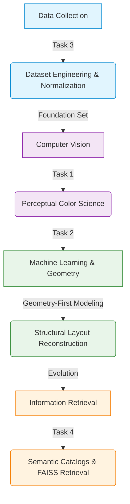
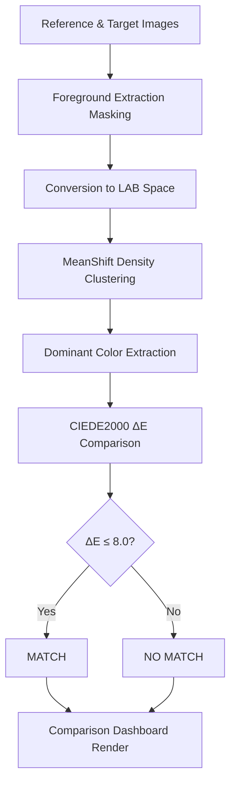
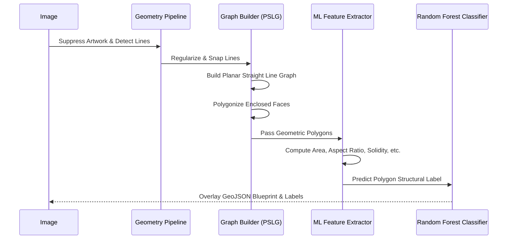
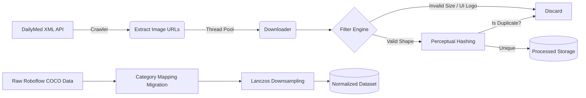

<<<<<<< Updated upstream
# 🚀 Silvertouch Internship Portfolio

> **Computer Vision, Machine Learning, Data Engineering & Semantic AI** — A comprehensive collection of intelligent systems developed during a technology internship, demonstrating the full AI/ML lifecycle from data collection to semantic decision-making.

<div align="center">


[Explore Projects](#-projects) • [View Architecture](#-architecture-journey) • [Tech Stack](#-technology-stack) • [Skills](#-skills-demonstrated)
=======
<div align="center">

# 🧪 Silvertouch Technologies Internship Portfolio
**Advanced Computer Vision, Geometric Machine Learning, and Information Retrieval Pipelines**

[](https://www.python.org/downloads/)
[](https://opencv.org/)
[](https://scikit-learn.org/)
[](https://github.com/facebookresearch/faiss)
[](https://shapely.readthedocs.io/en/stable/)

*A comprehensive technical showcase of real-world pharmaceutical packaging analysis, data engineering, and semantic AI systems developed during a professional internship.*

[Overview](#-executive-summary) • [Architecture](#-architecture-deep-dive) • [Projects](#-project-showcase) • [Skills](#-skills-demonstrated) • [Roadmap](#-future-roadmap)
>>>>>>> Stashed changes

</div>

---

<<<<<<< Updated upstream
## 📌 Quick Navigation

- [Overview](#-overview)
- [Projects](#-projects)
- [Architecture Journey](#-architecture-journey)
- [Repository Structure](#-repository-structure)
- [Technology Stack](#-technology-stack)
- [Skills Demonstrated](#-skills-demonstrated)
- [Deliverables](#-deliverables)
- [Getting Started](#-getting-started)

---

## 🎯 Overview

This repository showcases a collection of **integrated AI and software engineering projects** developed during an internship at Silvertouch Technologies. The work spans multiple domains and demonstrates how to architect, build, and deploy intelligent systems at scale.

### Problem Space

The internship tackled challenges across the AI/ML lifecycle:

1. **Perception & Understanding** — How do you teach machines to see and understand visual information like humans do?
2. **Geometry & Structure** — How can you recover hidden structure from visual data?
3. **Data Intelligence** — How do you build reliable, scalable pipelines to collect and prepare data?
4. **Semantic Understanding** — How do you enable non-technical users to query complex systems through natural language?

### Solution Approach

Rather than solving each problem independently, the projects build upon each other, demonstrating how modern AI systems integrate multiple technologies into cohesive platforms.

---

## 🎨 Projects

### Project Showcase

| # | Project | Domain | Status | Key Tech |
|---|---------|--------|--------|----------|
| 1️⃣ | **Perceptual Text Color Analysis** | Computer Vision | ✅ Complete | LAB Color Space, ΔE CIE2000, MeanShift |
| 2️⃣ | **Structural Packaging Intelligence** | Computer Vision + ML | ✅ Complete | Geometry, Random Forest, Polygonization |
| 3️⃣ | **Dataset Engineering Pipeline** | Data Engineering | ✅ Complete | Web Scraping, Deduplication, COCO Format |
| 4️⃣ | **Semantic SQL Generation** | NLP + LLMs | ✅ Complete | Transformers, RAG, Entity Extraction |

---

## 📊 Project Details

<details>
<summary><strong>Task 1: Perceptual Text Color Analysis</strong> — Determine if printed text colors match human perception</summary>

### Problem

Pharmaceutical packaging quality assurance requires verifying that printed text colors match design specifications. However, raw RGB values don't capture how humans perceive color differences.

### Solution

A perception-aware comparison pipeline using:
- **Foreground extraction** via color distance in LAB space
- **MeanShift clustering** to identify dominant ink colors
- **ΔE CIE2000** metric for perceptual color difference measurement
- **Visual dashboards** showing comparison results

### Pipeline

```
Image 1          Image 2
  ↓                ↓
Extract Foreground (LAB)
  ↓
MeanShift Clustering
  ↓
Dominant Color Detection
  ↓
ΔE Comparison (Threshold: 8.0)
  ↓
Dashboard Visualization
```

### Key Metrics

| Metric | Target | Result |
|--------|--------|--------|
| ΔE Threshold | ≤ 8.0 | ✅ PASS |
| Foreground Detection | Accurate | ✅ PASS |
| Color Family Classification | High Precision | ✅ PASS |

### Technologies

- **OpenCV** — Image I/O and preprocessing
- **NumPy** — Numerical operations
- **scikit-learn** — MeanShift clustering
- **colour-science** — CIE LAB and ΔE calculations
- **Matplotlib** — Visualization

### Output

`comparison_dashboard.png` — Side-by-side analysis with masks, clusters, swatches, and ΔE metrics

### Skills Demonstrated

`Color Science` • `Perception` • `Clustering` • `Image Analysis` • `Visualization`

</details>

<details>
<summary><strong>Task 2: Structural Packaging Intelligence</strong> — Recover physical carton structure from images</summary>

### Problem

Pharmaceutical cartons contain more than artwork. Their physical structure is defined by panels, fold lines, dust flaps, and glue tabs that determine how the package is manufactured and assembled.

Manually identifying these structural elements is time-consuming and difficult to scale across large packaging datasets.

### Solution

A geometry-first computer vision pipeline designed to reconstruct carton structure directly from images.

The system:

* Removes artwork and visual noise
* Detects structural boundaries and fold lines
* Constructs planar geometric representations
* Generates closed structural regions
* Extracts geometric features from recovered regions
* Classifies structural components using machine learning

### Workflow


### Key Capabilities

| Capability                   | Description                                              |
| ---------------------------- | -------------------------------------------------------- |
| Structural Boundary Recovery | Detects carton outlines and fold structures              |
| Planar Partition Generation  | Converts line networks into closed geometric regions     |
| Geometric Feature Extraction | Produces shape-based descriptors for classification      |
| Structural Classification    | Identifies panels, flaps, and tabs                       |
| Quality Auditing             | Validates topology, connectivity, and region consistency |

### Geometric Features (17-Dimensional Profile)

**Basic Properties:** Area, perimeter, relative area  
**Bounding Attributes:** Width, height, aspect ratio  
**Topological Complexity:** Solidity, extent, vertex count  
**Circular Properties:** Equivalent diameter, circularity  
**Rotation-Invariant:** Rotated dimensions, minimum area rectangle  
**Spatial Centroids:** X/Y coordinates

### Classification Results

| Metric | Result |
|--------|--------|
| Geometric Coverage | High accuracy on structured regions |
| Component Classification | Validated via topology |
| Boundary Extraction | GeoJSON-compliant output |

### Technologies

* **OpenCV** — Edge and image processing
* **Shapely** — Geometric operations and polygon handling
* **NumPy** — Numerical computation
* **scikit-learn** — Random Forest classification
* **GeoJSON** — Structural representation and export

### Outputs

* Structural overlays and visual reports
* Polygon and region definitions
* GeoJSON partition data
* Classification predictions
* Topology validation reports

### Skills Demonstrated

`Computer Vision` • `Geometric Reasoning` • `Feature Engineering` • `Machine Learning` • `Spatial Analysis` • `Pipeline Design`

</details>

<details>
<summary><strong>Task 3: Dataset Engineering Pipeline</strong> — Automated data collection, cleaning, and preparation</summary>

### Problem

Machine learning systems depend on high-quality datasets. Manual collection and preparation is time-consuming and error-prone. Scalable, reproducible data pipelines are essential.

### Solution

A comprehensive data engineering platform combining:
- **Web scraping** of pharmaceutical packaging sources at scale
- **Perceptual deduplication** using image hashing
- **Filtering** to remove irrelevant assets (thumbnails, UI elements)
- **Normalization** to standardized dimensions
- **Annotation mapping** to unified formats (COCO)
- **Dataset splitting** for training/validation/evaluation

### Data Pipeline

```
Raw Sources (DailyMed, Roboflow)
  ↓
Download Images (Multi-threaded)
  ↓
Perceptual Hashing & Deduplication
  ↓
Quality Filtering (Size, Aspect Ratio, Content)
  ↓
Resolution Normalization (Max 1000px, Lanczos)
  ↓
COCO Annotation Mapping & Alignment
  ↓
Dataset Splits (Train/Test/Validation)
  ↓
Unified Output Datasets
```

### Processing Features

| Feature | Implementation |
|---------|-----------------|
| Multi-threaded Downloads | Rapid parallel ingestion |
| Deduplication | Perceptual image hashing (phash) |
| Quality Filters | Aspect ratio, size, content validation |
| Session Resumption | Tracking for seamless restarts |
| Annotation Mapping | Unified category labels across sources |

### COCO Category Mapping

| ID | Label |
|----|-------|
| 1-2 | Artwork Classification |
| 3-8 | Structural Components (Panels, Flaps) |

### Dataset Outputs

| Split | Contents | Status |
|-------|----------|--------|
| `train/` | Training set with annotations | ✅ Ready |
| `test/` | Test set with annotations | ✅ Ready |
| `valid/` | Validation set with annotations | ✅ Ready |
| `Scrapped/output/` | DailyMed artwork cache | ✅ Complete |

### Technologies

- **Python requests** — HTTP downloads
- **PIL/Pillow** — Image processing and resizing
- **ImageHash** — Perceptual deduplication
- **pandas** — Data manipulation
- **Multi-threading** — Parallel processing

### Deliverables

- Deduplicated image corpus
- Standardized COCO annotations
- Metadata tracking (URLs, hashes, sizes)
- Reproducible ingestion logs

### Skills Demonstrated

`Web Scraping` • `Data Cleaning` • `Pipeline Automation` • `Deduplication` • `Scale Engineering` • `Quality Assurance`

</details>

<details>
<summary><strong>Task 4: Semantic SQL Generation & Entity Extraction</strong> — Natural language to database queries via LLMs</summary>

### Problem

Business users know what information they need but often don't know SQL. Creating user-friendly interfaces to complex databases requires bridging natural language and database queries.

### Solution

An intelligent query understanding system combining:
- **Semantic routing** to classify user intent and extract entities
- **Multi-source context retrieval** (DDL, documentation, similar SQL examples)
- **Relevance ranking** to assemble optimal prompts
- **Fine-tuned LLMs** (Transformers + PEFT/LoRA) to generate SQL
- **Entity extraction** with semantic validation

### Architecture

```
User Query + Context
  ↓
Semantic Intent Classification
  ├─→ Extract Entities (State, District, Sector)
  ├─→ Classify Intent (Statistics, Drill-down, Hierarchy)
  └─→ Route to Retrieval Pipeline
  ↓
Multi-Source Context Retrieval
  ├─→ DDL Retriever (Schema definitions)
  ├─→ Doc Retriever (Documentation snippets)
  ├─→ SQL Retriever (Similar examples)
  └─→ Embedding Retriever (FAISS semantic search)
  ↓
Context Ranking & Assembly
  ├─→ Relevance scoring (BM25 + embeddings)
  ├─→ Multi-source combination
  └─→ Final prompt construction
  ↓
LLM Inference
  ├─→ Fine-tuned Model (PEFT/LoRA)
  └─→ Generate SQL with explanation
  ↓
Output Assembly
  └─→ SQL + Confidence + Entities + Metadata
```

### Core Components

| Component | Purpose | Technology |
|-----------|---------|------------|
| **Semantic Router** | Intent & entity classification | Embeddings + ML |
| **DDL Retriever** | Schema information | Database introspection |
| **Doc Retriever** | Documentation search | BM25 + semantic search |
| **SQL Retriever** | Similar query examples | Lexical + semantic matching |
| **Context Ranker** | Multi-source aggregation | Relevance scoring |
| **LLM Inference** | Query generation | Transformers + PEFT |
| **Entity Extractor** | Semantic entity recognition | Regex + ML classification |
| **Evaluator** | Quality metrics | EM, F1, BLEU, MRR, NDCG |

### Semantic Catalog

Unified enterprise ontology defining:
- **Concept definitions** (State, District, Sector)
- **Aliases and variations**
- **Module mappings** (which business module owns each concept)
- **Related tables & columns**
- **Parent/child hierarchies**
- **Confidence scores**

Example:
```json
{
  "concept": "State",
  "definition": "Primary administrative division",
  "modules": ["GP_COVERAGE", "COOPERATIVE"],
  "related_tables": ["locations", "districts"],
  "confidence": 0.99
}
```

### Evaluation Metrics

| Metric | Purpose |
|--------|---------|
| **EM** (Exact Match) | Correct SQL matches exactly |
| **F1** (Partial Match) | Token-level overlap |
| **BLEU** | N-gram similarity |
| **MRR** | Retrieval ranking quality |
| **NDCG** | Context relevance ranking |
| **Entity F1** | Entity extraction precision/recall |

### Technologies

- **Transformers** — Pre-trained LLM backbone
- **PEFT/LoRA** — Efficient fine-tuning
- **FAISS** — Vector similarity search
- **Sentence Transformers** — Semantic embeddings
- **SQLAlchemy** — Query validation
- **FastAPI** — Production API deployment
- **scikit-learn** — ML components (routing, extraction)

### Example Usage

```python
# Initialize components
router = SemanticRouter()
retriever = ContextRetriever()
model = LLMInference()

# Process query
query = "Show state-wise dairy cooperative statistics"
context = UserContext(state="Maharashtra", role="analyst")

# Route and extract
routing = router.route(query, context)  # Intent + entities
context_results = retriever.retrieve(routing['entities'])  # Multi-source
prompt = assemble_prompt(query, context_results)

# Generate SQL
sql = model.generate(prompt)
```

### Deliverables

- Fine-tuned model weights (PEFT/LoRA)
- FAISS embedding indices
- Semantic catalog (JSON)
- Evaluation reports with metrics
- Production-ready inference API

### Skills Demonstrated

`NLP` • `LLM Fine-tuning` • `Semantic Search` • `Entity Extraction` • `Information Retrieval` • `RAG Systems` • `API Design`
=======
## 📋 Table of Contents

<details open>
<summary><strong>Expand / Collapse Contents</strong></summary>

- [Executive Summary](#-executive-summary)
- [Repository Highlights](#-repository-highlights)
- [Internship Journey](#-internship-journey)
- [Project Showcase](#-project-showcase)
- [Detailed Project Sections](#-detailed-project-sections)
  - [Task 1: Perceptual Text-Color Comparison](#1-task-1--perceptual-text-color-comparison)
  - [Task 2: Structural Packaging Layout Reconstruction](#2-task-2--structural-packaging-layout-reconstruction)
  - [Task 3: DailyMed Scraper & Dataset Curation](#3-task-3--dailymed-scraper--dataset-curation)
  - [Task 4: Semantic Catalog & Dense Retrieval System](#4-task-4--semantic-catalog--dense-retrieval-system)
- [Architecture Deep Dive](#-architecture-deep-dive)
- [Technology Stack](#-technology-stack)
- [Skills Demonstrated](#-skills-demonstrated)
- [Engineering Principles](#-engineering-principles)
- [Deliverables](#-deliverables)
- [Challenges & Learnings](#-challenges--learnings)
- [Repository Structure](#-repository-structure)
- [Future Roadmap](#-future-roadmap)
- [Appendix](#-appendix)
>>>>>>> Stashed changes

</details>

---

<<<<<<< Updated upstream
## 🏗️ Architecture Journey

The projects form an integrated AI/ML lifecycle:


### The AI/ML Lifecycle in Practice

| Stage | Task | Input | Output | Technology |
|-------|------|-------|--------|-----------|
| **1. Data** | Scraping + Cleaning | Raw web content | Curated datasets | Web scraping, deduplication |
| **2. Understanding** | Computer Vision | Images | Features, segments | OpenCV, geometry |
| **3. Learning** | ML Classification | Features + labels | Trained models | scikit-learn, RF |
| **4. Intelligence** | Semantic AI | Natural language | Structured queries | Transformers, retrieval |
| **5. Action** | Decision Support | Queries + results | Insights & automation | LLMs, APIs |
=======
## 🚀 Executive Summary

During my internship at **Silvertouch Technologies**, I focused on designing, architecting, and deploying sophisticated AI pipelines to solve complex problems in pharmaceutical packaging analysis and semantic data retrieval. This repository serves as a professional portfolio documenting the complete lifecycle of these engineered solutions.

The internship traversed multiple advanced domains, including **Computer Vision (CV)**, **Geometric Machine Learning**, **Data Engineering**, and **Information Retrieval (IR)**. Instead of relying solely on black-box deep learning models, the projects heavily emphasize hybrid approaches—combining deterministic algorithms (like Planar Straight Line Graphs and morphological geometry) with statistical machine learning (Random Forests) and perceptual clustering (MeanShift in LAB space).

### Core Systems Built
1. **Perceptual Text-Color Matching System:** A pipeline that mimics human color perception using LAB color spaces and CIEDE2000 metrics to verify pharmaceutical warning label consistency.
2. **Geometry-First Structural Reconstruction:** A mathematical and machine learning hybrid pipeline that reconstructs exact manufacturing blueprint layouts from raw 2D carton images.
3. **Automated Data Engineering Pipeline:** A multi-threaded, robust web crawler and dataset normalization engine built to scrape, deduplicate, and curate the DailyMed pharmaceutical database.
4. **Dense Retrieval Engine:** A high-performance Information Retrieval system leveraging FAISS and dense embeddings to accurately locate schema documentation and DDLs for a future Text-to-SQL architecture.

This portfolio demonstrates my ability to tackle end-to-end software engineering challenges, from scraping raw data and designing core algorithms to establishing scalable, reproducible architectures and deploying dense vector search.
>>>>>>> Stashed changes

---

## 📊 Repository Highlights

The following dashboard summarizes the scale, focus, and core technologies leveraged throughout the internship.

| Category | Value / Focus |
| :--- | :--- |
| **Primary AI Domains** | Computer Vision, Information Retrieval, Geometric Modeling, Data Engineering |
| **Major Engineered Systems** | 4 Special-Purpose Pipelines |
| **Core Languages** | Python 3.11+, Bash |
| **Vision & Geometry Stack** | OpenCV, scikit-image, Shapely, PIL |
| **Machine Learning Stack** | Scikit-learn (Random Forests, MeanShift), Joblib |
| **Information Retrieval Stack** | FAISS (Vector Indexing), Dense Text Embeddings |
| **Data Engineering** | Multithreading, Perceptual Hashing (ImageHash), Pandas |
| **Key Optimization Metrics** | Geometric Overlap %, Vector Retrieval Recall, ΔE Perceptual Thresholds |
| **Architectural Patterns** | Modular Pipelines, Dependency Injection, Extract-Transform-Load (ETL) |

---

## 🗺️ Internship Journey

The internship followed a logical, progressive narrative. I began with fundamental data engineering to acquire raw assets, transitioned into perceptual vision analysis, escalated into complex geometric and machine learning hybrids, and ultimately arrived at advanced semantic AI systems.


<<<<<<< Updated upstream
Silvertouch_Internship/
│
├── task1/                          # 🎨 Perceptual Text Color Analysis
│   ├── main.py                     # Entry point
│   ├── config.py                   # Configuration & thresholds
│   ├── data/                       # Reference & target images
│   ├── outputs/                    # Comparison dashboards
│   ├── preprocessing/              # Image loading & foreground extraction
│   ├── clustering/                 # MeanShift color clustering
│   ├── color_processing/           # LAB space, ΔE, color families
│   └── visualization/              # Dashboard rendering
│
├── task2_neural_network/           # 🏭 Structural Packaging Intelligence
│   ├── generate_and_ingest.py      # Data preparation pipeline
│   ├── analyze_masks.py            # Coverage statistics
│   ├── config/                     # Configuration files
│   ├── data/                       # Raw, interim, processed datasets
│   ├── models/                     # Trained Random Forest models
│   ├── src/
│   │   ├── geometry/               # Edge, line, PSLG, polygonization
│   │   ├── features/               # Geometric feature extraction
│   │   ├── models/                 # RF classifier wrapper
│   │   ├── training/               # Model training & evaluation
│   │   ├── pipeline/               # Orchestration pipelines
│   │   ├── blueprint/              # Boundary filtering & validation
│   │   ├── analysis/               # Structural auditing
│   │   ├── core/                   # Shared data structures
│   │   └── utils/                  # Helpers & logging
│   └── tests/                      # Unit tests
│
├── task3/                          # 📥 Dataset Engineering Pipeline
│   ├── train/                      # Training split
│   ├── test/                       # Test split
│   ├── valid/                      # Validation split
│   ├── Scrapped/                   # DailyMed scraper
│   │   ├── src/
│   │   │   ├── main.py             # Scraper entry point
│   │   │   ├── crawler.py          # URL extraction
│   │   │   ├── downloader.py       # Multi-threaded downloads
│   │   │   ├── filters.py          # Quality filtering
│   │   │   └── utils.py            # Deduplication
│   │   └── output/                 # Downloaded images & metadata
│   ├── resize_dataset.py           # Resolution normalization
│   ├── migrate_test.py             # COCO annotation mapping
│   ├── migrate_valid.py            # Validation set mapping
│   └── combine_eval.py             # Dataset split merging
│
├── task4/                          # 🧠 Semantic SQL Generation
│   ├── data/
│   │   ├── raw/                    # Raw SQL/DDL/docs
│   │   ├── processed/              # Fine-tuning JSONL
│   │   ├── embeddings/             # FAISS indices
│   │   ├── semantic_catalog/       # Entity definitions
│   │   └── benchmark/              # Test queries
│   ├── src/
│   │   ├── context/                # User context dataclass
│   │   ├── data_pipeline/          # Dataset building
│   │   ├── ingestion/              # Corpus & profiling
│   │   ├── retrieval/              # Multi-source retrievers
│   │   ├── routing/                # Intent & entity classification
│   │   ├── evaluation/             # Metrics & benchmarking
│   │   └── utils/                  # File ops & reporting
│   ├── scripts/                    # Analysis & utility scripts
│   ├── tests/                      # Unit & integration tests
│   └── requirements.txt            # LLM & NLP dependencies
│
├── src/                            # 🔧 Shared Utilities
│   └── visualization/              # Cross-task visualization helpers
│
└── README.md                       # 📖 This file
```

<details>
<summary><strong>View Detailed Module Breakdown</strong></summary>

### Task 1 Modules

| Module | Classes/Functions | Purpose |
|--------|-------------------|---------|
| `preprocessing/` | `load_image()`, `extract_foreground()`, `estimate_background()` | Image I/O and foreground isolation |
| `clustering/` | `MeanShiftExtractor` | Density-based color clustering |
| `color_processing/` | `CompareColors`, `get_dominant_color()`, `get_color_family()`, `rgb_to_hex()` | Color operations & comparisons |
| `visualization/` | `generate_comparison_dashboard()` | Multi-panel result rendering |

### Task 2 Modules

| Module | Classes/Functions | Purpose |
|--------|-------------------|---------|
| `geometry/` | `EdgeDetector`, `LineDetector`, `PSLGBuilder`, `Polygonizer` | Structural boundary recovery |
| `features/` | `extract_geometric_features()` | 17-dimensional geometric profiles |
| `models/` | `StructuralMaskRFClassifier` | Random Forest wrapper |
| `blueprint/` | `ContainmentFilter`, `TinyFaceFilter`, `StructuralRegionMerger` | Boundary filtering & consolidation |
| `training/` | `train_model()` | Model training & validation |

### Task 4 Modules

| Module | Classes/Functions | Purpose |
|--------|-------------------|---------|
| `routing/` | `SemanticRouter`, `EntityExtractor` | Intent & entity classification |
| `retrieval/` | `DDLRetriever`, `DocRetriever`, `SQLRetriever`, `EmbeddingRetriever`, `ContextRanker` | Multi-source context assembly |
| `evaluation/` | `Evaluator`, Router/Retriever benchmarks | Metrics & quality analysis |
| `data_pipeline/` | `build_dataset()` | Training data preparation |

</details>

---

## 🛠️ Technology Stack

### Computer Vision & Image Processing

| Technology | Usage |
|------------|-------|
| **OpenCV** | Edge detection, line detection, filtering, image I/O |
| **PIL/Pillow** | Image resizing, format conversion |
| **scikit-image** | Advanced morphological operations |
| **NumPy** | Numerical array operations |

### Color Science & Perception

| Technology | Usage |
|------------|-------|
| **colour-science** | CIE LAB color space, ΔE CIE2000 calculations |
| **scikit-learn** | MeanShift clustering for dominant colors |

### Geometry & Spatial Processing

| Technology | Usage |
|------------|-------|
| **Shapely** | Polygon operations, geometric reasoning |
| **Matplotlib/seaborn** | Visualization & plotting |

### Machine Learning & Classification
=======

* **Phase 1 (Data):** Harvesting and curating pharmaceutical imagery.
* **Phase 2 (Vision):** Understanding images at the pixel and perceptual level.
* **Phase 3 (Structure):** Extracting mathematical boundaries and training classification models.
* **Phase 4 (Semantics):** Moving beyond pixels into text, schemas, and high-dimensional semantic search.

---

## 🏆 Project Showcase

Below is a high-level showcase of the distinct engineering projects housed within this repository. All projects receive equal focus, demonstrating a well-rounded software engineering and applied AI skill set.

| Project Directory | Domain | Status | Core Technologies | Primary Outcome |
| :--- | :--- | :--- | :--- | :--- |
| `task1/` | Computer Vision | **✅ Completed** | OpenCV, scikit-learn, colour-science | Perceptual Dashboard Output |
| `task2_neural_network/` | ML & Geometry | **✅ Completed** | Shapely, scikit-learn, Random Forests | Structural GeoJSON Blueprints |
| `task3/` | Data Engineering | **✅ Completed** | ImageHash, ThreadPoolExecutor, PIL | Deduplicated, Normalized Dataset |
| `task4/` | Information Retrieval | **🚧 Active** | FAISS, Dense Embeddings | Semantic Retrieval Pipelines |

---

## 🔬 Detailed Project Sections

### 1. Task 1 — Perceptual Text-Color Comparison

#### Overview
Task 1 evaluates whether the text color on two separate pharmaceutical carton crops is identical. Crucially, it models how the **human eye** perceives color rather than relying on naive mathematical RGB distances.

#### Why It Matters
In pharmaceutical manufacturing, strict brand and warning label consistency is required by law. Lighting anomalies, printing artifacts, and background gradients can drastically alter standard pixel values. A perceptual pipeline ensures absolute quality control without false positives caused by manufacturing gloss or scanner lighting.

#### Problem Statement
Simple color comparisons (like Euclidean distance in RGB space) fail because RGB is not perceptually uniform—a mathematical difference of 10 in blue looks entirely different to the human eye than a difference of 10 in green.

#### What Was Built
A high-fidelity comparison engine that isolates text, maps colors into the perceptually uniform **LAB color space**, groups them via density algorithms, and scores similarities using the **CIEDE2000 (ΔE)** industry standard.

#### Workflow & Architecture



#### Technologies
* **`scikit-learn`**: MeanShift clustering.
* **`colour-science`**: Delta E (CIE2000) computation and family mapping.
* **`numpy` & `cv2`**: Matrix operations and image transformations.

#### Engineering Decisions
* **Choosing MeanShift over K-Means:** We cannot predict how many ink colors exist on a crop. MeanShift finds density peaks dynamically without requiring a predefined `k` value.
* **Using LAB Color Space:** LAB isolates luminance (L) from color channels (A, B), making it highly resistant to lighting/shadow variations across packaging.

#### Key Deliverables
* `outputs/comparison_dashboard.png`: A comprehensive side-by-side visualization showing extracted masks, spatial clusters, dominant swatches, and the final ΔE mathematical justification.

---

### 2. Task 2 — Structural Packaging Layout Reconstruction

#### Overview
Task 2 reconstructs the structural blueprint of a pharmaceutical carton—identifying the exact planar coordinates of panels, dust flaps, and glue tabs from a 2D image.

#### Why It Matters
While modern Deep Learning (like the Segment Anything Model / SAM) is excellent at finding objects, it outputs organic, wavy boundaries. Packaging and manufacturing require strict, mathematically perfect lines (straight edges, sharp corners). 

#### Problem Statement
How do we convert raw pixels or noisy neural network masks into a strict, topological blueprint composed of precise geometric polygons, and then classify the purpose of each polygon?

#### What Was Built
A **hybrid pipeline** comprising two parallel systems:
1. **Geometry-First Planar Partitioning:** A mathematical pipeline that enforces structural rigidity.
2. **Machine Learning Classifier:** A Random Forest model trained on 17 custom-extracted geometric properties.

#### Workflow & Architecture

<details>
<summary><strong>View Architecture Diagram</strong></summary>


</details>

#### Technologies
* **`Shapely`**: Advanced geometric operations, intersections, and polygon building.
* **`scikit-learn`**: Random Forest classification (`StructuralMaskRFClassifier`).
* **`OpenCV`**: Hough line transforms, bilateral filtering, Canny edge detection.

#### Engineering Decisions
* **Geometry-First Design:** By enforcing a Planar Straight Line Graph (PSLG), we guarantee that no polygons overlap and that all edges are shared cleanly—perfectly mimicking a real CAD file.
* **Custom Geometric Feature Engineering:** Instead of passing raw pixels to a CNN, we extract 17 features (solidity, circularity, rotated aspect ratio) allowing a lightweight, highly explainable Random Forest to perform classification.

#### Key Deliverables
* Automatically generated `segments.json` files mapping precise geometric coordinates.
* Visual boundary overlays and false-color segment maps indicating structural hierarchy.
* Trained `.joblib` classification models.

---

### 3. Task 3 — DailyMed Scraper & Dataset Curation

#### Overview
Task 3 is a robust Data Engineering project. It automates the scraping of pharmaceutical packaging artwork from the FDA's DailyMed database and curates/normalizes unstructured Roboflow annotation datasets for downstream model training.

#### Why It Matters
AI is only as good as its data. Manual downloading of datasets is unscalable. Furthermore, pharmaceutical databases are fraught with duplicate entries, irrelevant logos, and widely varying image resolutions that break neural network memory constraints.

#### Problem Statement
We required a fault-tolerant system to extract thousands of XML-based records from a web API, download relevant imagery, eliminate duplicates, and standardize existing dataset annotations into a unified taxonomy.

#### What Was Built
* A multi-threaded, robust web scraper.
* A dataset curation engine that standardizes bounding box annotations and downsamples massive imagery.

#### Workflow & Architecture



#### Technologies
* **`concurrent.futures`**: ThreadPoolExecutor for rapid, parallel I/O bound downloads.
* **`ImageHash`**: Generating perceptual hashes (`phash`) to mathematically prove image duplication.
* **`PIL (Pillow)`**: High-quality Lanczos resampling.
* **`json` & `pandas`**: Metadata tracking and logging.

#### Engineering Decisions
* **Perceptual Hashing over MD5:** Standard cryptography hashes (MD5) change completely if a single pixel differs. Perceptual hashing generates the same fingerprint for visually similar images, effectively eliminating near-duplicates from the dataset.
* **Lanczos Filtering:** Used for down-sampling high-resolution images because it preserves critical edge information much better than nearest-neighbor or bilinear interpolation.

#### Key Deliverables
* A clean repository of deduplicated artwork images.
* Normalized `eval_combined` datasets with unified COCO label taxonomies and capped dimensions (max 1000px).

---

### 4. Task 4 — Semantic Catalog & Dense Retrieval System

#### Overview
Task 4 serves as the foundation for an advanced Information Retrieval (IR) architecture. It focuses on the **dense retrieval** of semantic catalogs, schema DDLs, and database documentation using vector search. 

> **Important Status Correction:** Task 4 is currently an active Retrieval architecture. While the ultimate long-term goal involves Natural Language to SQL (Text-to-SQL) generation, **generation is NOT currently implemented or active.** The system currently focuses entirely on high-accuracy context retrieval.

#### Current Status Breakdown

| Phase | Status | Details |
| :--- | :---: | :--- |
| **Dataset Analysis** | ✅ | Schema analysis and taxonomy construction completed. |
| **Semantic Catalog Development** | ✅ | Built metadata stores defining entity relationships. |
| **Document/DDL Retrieval** | ✅ | Engine capable of fetching specific schema layouts. |
| **Embedding Generation** | ✅ | Text chunks successfully mapped to dense vector spaces. |
| **FAISS Indexing** | ✅ | High-speed vector index constructed and operational. |
| **Retrieval Evaluation** | ✅ | Benchmarking top-K recall accuracy for context ranking. |
| **Semantic Routing** | 🚧 | *In Progress* - Parsing user intent to target specific indices. |
| **Context Assembly** | 🚧 | *In Progress* - Formatting retrieved vectors into LLM prompts. |
| **NL → SQL Generation** | 🔮 | *Planned Future Work.* |
| **LLM Fine-tuning / LoRA** | 🔮 | *Planned Future Work.* |

#### Why It Matters
Before a Large Language Model can accurately generate complex SQL queries, it must be fed the exact, correct database schema context. Relying on simple keyword search fails when users utilize domain-specific synonyms. A dense vector retrieval system understands semantic meaning.

#### Problem Statement
How do we rapidly and accurately retrieve the correct table DDLs and semantic definitions out of hundreds of possibilities, based purely on natural language queries?

#### What Was Built
A high-performance Dense Retrieval pipeline utilizing embeddings to represent schema concepts in a multi-dimensional space, indexed by Facebook AI Similarity Search (FAISS).

#### Technologies
* **`FAISS`**: Sub-millisecond dense vector similarity search.
* **Dense Embeddings**: Converting textual catalogs into float vectors.
* **Vector Metrics**: Cosine similarity / L2 distance ranking.

#### Engineering Decisions
* **Decoupling Retrieval from Generation:** We purposefully built and evaluated the retrieval engine independently. If the context retrieved is wrong, any downstream SQL generation will fail. Benchmarking retrieval guarantees system stability before introducing LLM token generation.

#### Key Deliverables
* Semantic catalog definitions.
* FAISS vector indices mapping schema documentation.
* Retrieval benchmark scripts and ranking experiments.

---

## 🏛️ Architecture Deep Dive

This repository leverages distinct architectural paradigms depending on the domain.

### Computer Vision Systems (Perceptual & Morphological)
Instead of treating images purely as tensors, the architecture breaks them down into semantic components. In Task 1, foreground extraction relies on localized background estimation. In Task 2, "Artwork Suppression" uses `cv2.morphologyEx` (Bilateral filtering + Morphological Openings) to explicitly erase high-contrast text before edge detection even begins, preventing the Hough line transformer from hallucinating geometric edges around printed words.

### Geometric Processing Systems (PSLG)
The core architecture of Task 2 revolves around a Planar Straight Line Graph (PSLG). The `PSLGBuilder` treats intersection points as graph **Nodes** and lines as graph **Edges**. By traversing this mathematical graph, the `Polygonizer` can definitively extract closed regions without any pixel-level ambiguity.

### Data Engineering Pipelines
Task 3 implements an ETL (Extract, Transform, Load) pattern. It decouples the `Crawler` (parsing XML state), the `Downloader` (I/O thread pool execution), and the `Filters` (business logic for rejecting data). This separation of concerns allows execution to be paused and resumed seamlessly using local state files.

### Retrieval Systems
Task 4 implements a Dense Vector architecture. Documents (DDLs, semantic notes) are chunked, embedded into high-dimensional vectors, and stored in a FAISS index. At query time, the user's string is embedded, and the system performs a K-Nearest Neighbors (KNN) search across the index space.

---

## 🛠️ Technology Stack

The internship utilized a diverse and robust technology stack:

#### Programming & Core Utilities
* **Python (3.11+)**: Strict typing, pattern matching (`match`/`case`), and object-oriented design.
* **Pandas**: Tabular metadata manipulation and dataset analytics.
* **Joblib**: Efficient serialization of trained machine learning models.

#### Computer Vision & Geometry
* **OpenCV (`cv2`)**: Core matrix manipulation, filtering, and edge detection.
* **scikit-image (`skimage`)**: Advanced contouring and geometric property measurement.
* **Pillow (`PIL`)**: Image resampling and format handling.
* **Shapely**: Advanced polygon boolean logic and intersection math.

#### Machine Learning & Retrieval
* **scikit-learn**: Random Forests, MeanShift clustering, Model evaluation metrics.
* **colour-science**: Complex CIE perceptual color space transformations.
* **FAISS**: Facebook's library for efficient similarity search and clustering of dense vectors.

---

## 🧠 Skills Demonstrated

The following professional skills were extensively developed and demonstrated across the codebase.

| Area of Expertise | Demonstrated Skills | Repository Implementation Examples |
| :--- | :--- | :--- |
| **Computer Vision** | Morphological filtering, color space conversions, edge/line extraction | `task1` background estimation, `task2` artwork suppressor |
| **Geometric Reasoning** | Graph traversal, polygonization, topological validity | `task2` PSLG builder, containment filtering |
| **Feature Engineering** | Mathematical shape profiling, extracting translation-invariant bounds | `task2` 17-dimensional `extract_geometric_features` |
| **Classification ML** | Training tree-based models, preventing data leakage via group splits | `task2` Structural Random Forest classifier |
| **Data Engineering** | Multithreading, idempotent scraping, perceptual hashing | `task3` DailyMed crawler and deduplicator |
| **Information Retrieval** | Dense vector search, indexing, top-k evaluation metrics | `task4` FAISS indexing and retrieval benchmark |
| **Software Architecture** | Object-Oriented Pipelines, Strategy Patterns, clear module segregation | `src/` modular design across all tasks |

---

## 📐 Engineering Principles

* **Modularity:** Pipelines are heavily broken into discrete classes (e.g., `EdgeDetector`, `LineRegularizer`, `FaceCleanupAudit`), allowing individual testing and swapping of logic without breaking the system.
* **Explainability:** By avoiding end-to-end black-box deep learning for structure and color, the systems can mathematically explain *why* they made a decision (e.g., Outputting a specific ΔE value, or explicitly citing a polygon's aspect ratio).
* **Reproducibility:** Use of deterministic random seeds during Random Forest training, configuration files (`config.py`), and explicit dependency management (`requirements.txt`).
* **Robustness:** Web scrapers track session states to resume from network failures; CV pipelines utilize robust fallback thresholds.

---

## 📦 Deliverables

Throughout the internship, the following key artifacts were produced:
* **Dashboards:** Automated, visually rich PNG comparison reports.
* **Datasets:** Cleaned, deduplicated, and unified packaging imagery.
* **Blueprints:** Exact geometric GeoJSON outputs of packaging layouts.
* **Models:** Trained `.joblib` machine learning classifiers.
* **Indices:** Compiled FAISS semantic vector stores.
* **Evaluation Assets:** CSV histograms, coverage reports, and ranking logs.

---

## 🧗 Challenges & Learnings

### 1. The Reality of Neural Network Segmentation
**Challenge:** Initially exploring raw Neural Network segmentation (like SAM) revealed that Deep Learning struggles with absolute physical rigidity. Masks would "bleed" across physical carton folds.
**Learning:** Pure AI is not always the answer. Developing the geometry-first PSLG pipeline taught me the immense value of classical mathematical constraints. Forcing the system to snap to detected lines solved the bleeding issue entirely.

### 2. The Nuance of Color Perception
**Challenge:** Comparing text colors was failing due to lighting gradients causing massive RGB variances across a single box.
**Learning:** I learned the intricacies of color science. Transitioning to the LAB color space separated the brightness (L) from the actual pigment (A/B), drastically improving the system's resilience to shadows.

### 3. Engineering Resilient Data Pipelines
**Challenge:** The DailyMed scraper would frequently fail midway through a 10,000 image download due to API timeouts, resulting in lost data.
**Learning:** I learned to engineer resilient ETL pipelines by implementing local state caching. The system now logs completed IDs to disk, allowing it to resume exactly where it left off. Furthermore, implementing perceptual hashing taught me how to effectively deduplicate massive visual datasets.

### 4. Dense Retrieval Ambiguity
**Challenge:** In Task 4, creating the FAISS index highlighted how overlapping database schema definitions confuse retrieval systems if the context chunks are too large.
**Learning:** Evaluating the retrieval system taught me the importance of optimal chunk sizing and comprehensive semantic metadata tagging prior to vectorization.

---

## 📂 Repository Structure

Below is the high-level architecture of the repository workspace.

<details open>
<summary><strong>Expand Directory Tree</strong></summary>

```text
Silvertouch_Internship/
├── .gitignore
├── README.md                           ← This Documentation
├── src/                                ← Shared Repository Utilities
│
├── task1/                              ← Text-Color Perceptual Matching
│   ├── config.py                       
│   ├── main.py                         
│   ├── clustering/                     ← MeanShift Algorithms
│   ├── color_processing/               ← LAB and CIEDE2000 math
│   ├── preprocessing/                  ← Foreground/Background isolation
│   └── visualization/                  
│
├── task2_neural_network/               ← Geometry & ML Layout Reconstruction
│   ├── config/                         
│   ├── src/
│   │   ├── analysis/                   ← System audits and metrics
│   │   ├── blueprint/                  ← Structural consolidation filters
│   │   ├── features/                   ← Geometric feature engineering
│   │   ├── geometry/                   ← Line detection & PSLG Builder
│   │   ├── models/                     ← Random Forest classifiers
│   │   └── pipeline/                   ← Orchestration logic
│   └── training/                       ← Model generation scripts
│
├── task3/                              ← Data Engineering & Scraping
│   ├── Scrapped/
│   │   └── src/                        ← Crawler, Downloader, Hash Deduplicator
│   ├── combine_eval.py                 ← Normalization scripts
│   └── resize_dataset.py               
│
└── task4/                              ← Information Retrieval System
    ├── configs/
    ├── data/
    ├── docs/
    ├── src/                            ← Embeddings, FAISS indexing, Retrieval logic
    └── scripts/
```
>>>>>>> Stashed changes

| Technology | Usage |
|------------|-------|
| **scikit-learn** | Random Forest classification, feature processing |
| **pandas** | Data manipulation and analysis |

<<<<<<< Updated upstream
### NLP & Large Language Models

| Technology | Usage |
|------------|-------|
| **Transformers** | Pre-trained LLM backbone, semantic embeddings |
| **PEFT** | Parameter-efficient fine-tuning (LoRA) |
| **FAISS** | Vector similarity search & indexing |
| **Sentence Transformers** | Semantic embedding generation |
| **SQLAlchemy** | SQL parsing and validation |

### Data Engineering

| Technology | Usage |
|------------|-------|
| **requests** | HTTP downloads for web scraping |
| **ImageHash** | Perceptual image deduplication |
| **Multi-threading** | Parallel processing for scalability |

### Development & Deployment

| Technology | Usage |
|------------|-------|
| **FastAPI** | Production API servers |
| **pytest** | Unit and integration testing |
| **joblib** | Model serialization |

---

## 🎓 Skills Demonstrated

### Computer Vision & Image Processing

✅ Foreground/background separation  
✅ Edge and boundary detection  
✅ Line detection & regularization  
✅ Polygon extraction & validation  
✅ Image filtering & morphological operations  
✅ Perceptual color science  

### Machine Learning & Feature Engineering

✅ Unsupervised clustering (MeanShift)  
✅ Supervised classification (Random Forest)  
✅ Feature engineering & extraction  
✅ Cross-validation strategies (GroupShuffleSplit)  
✅ Model evaluation & benchmarking  
✅ Handling class imbalance  

### Natural Language Processing & LLMs

✅ Semantic intent classification  
✅ Entity extraction & recognition  
✅ Retrieval-augmented generation (RAG)  
✅ Semantic search (FAISS)  
✅ Fine-tuning with PEFT/LoRA  
✅ Context ranking & assembly  

### Data Engineering & Pipeline Development

✅ Web scraping at scale  
✅ Data cleaning & deduplication  
✅ Annotation format conversion  
✅ Multi-threaded processing  
✅ Reproducible data pipelines  
✅ Dataset versioning & tracking  

### Software Engineering & Architecture

✅ Modular system design  
✅ Component abstraction & inheritance  
✅ Configuration management  
✅ Error handling & validation  
✅ Unit testing  
✅ Documentation & logging  
✅ API design (FastAPI)  

---

## 📦 Deliverables

### Task 1 Outputs

| Artifact | Format | Description |
|----------|--------|-------------|
| `comparison_dashboard.png` | PNG | Visual comparison with metrics |

### Task 2 Outputs

| Artifact | Format | Description |
|----------|--------|-------------|
| `overlay.png` | PNG | Colored region overlay |
| `segment_map.png` | PNG | False-color segmentation |
| `segments.json` | JSON | Labeled components & bboxes |
| `report.json` | JSON | Structural metrics |
| Trained Models | `.joblib` | Random Forest classifiers |

### Task 3 Outputs

| Artifact | Format | Description |
|----------|--------|-------------|
| `train/`, `test/`, `valid/` | Directories | Standardized dataset splits |
| `images.csv` | CSV | Metadata (URL, size, hash) |
| `duplicates.csv` | CSV | Deduplication tracking |
| `images/` | Directory | Downloaded artwork cache |

### Task 4 Outputs

| Artifact | Format | Description |
|----------|--------|-------------|
| `train.jsonl` | JSONL | Fine-tuning dataset |
| `faiss_index.bin` | Binary | Semantic search index |
| `lora_adapter.safetensors` | Weights | Fine-tuned model adapter |
| `eval_report.json` | JSON | Metrics (EM, F1, MRR, NDCG) |
| `quality_report.json` | JSON | SQL error analysis |

---

## 🚀 Getting Started

### Prerequisites

- **Python 3.11+**
- **Virtual environment** (venv or conda)
- **Git**

### Installation

```bash
# Clone repository
git clone https://github.com/Meetjo656/Silvertouch_Internship.git
cd Silvertouch_Internship

# Create virtual environment
python -m venv .venv
source .venv/bin/activate  # macOS/Linux
# .venv\Scripts\activate   # Windows

# Install base dependencies
pip install opencv-python numpy scikit-learn colour-science scikit-image pandas shapely matplotlib seaborn joblib imagehash

# Install task-specific dependencies
pip install -r task2_neural_network/requirements.txt
pip install -r task3/Scrapped/requirements.txt
pip install -r task4/requirements.txt
```

### Running Tasks

<details>
<summary><strong>Task 1: Text Color Comparison</strong></summary>

```bash
cd task1
python main.py
```

**Expected output:** `outputs/comparison_dashboard.png`

</details>

<details>
<summary><strong>Task 2: Structural Analysis</strong></summary>

```bash
cd task2_neural_network

# Analyze masks
python analyze_masks.py

# Train classifier
python -m src.training.train --project_root . --n_estimators 500

# Run pipelines
python -m src.pipeline.geometry_pipeline
python -m src.pipeline.phase_7b_lite_pipeline
```

**Expected outputs:** GeoJSON boundaries, segment maps, trained models

</details>

<details>
<summary><strong>Task 3: Dataset Pipeline</strong></summary>

```bash
cd task3

# Run DailyMed scraper
python Scrapped/src/main.py

# Normalize dataset
python resize_dataset.py

# Map annotations
python migrate_test.py
python migrate_valid.py
python combine_eval.py
```

**Expected outputs:** Standardized train/test/valid splits with COCO annotations

</details>

<details>
<summary><strong>Task 4: Semantic SQL Generation</strong></summary>

```bash
cd task4

# Prepare data
python -m src.data_pipeline.build_dataset
python scripts/analyze_dataset.py

# Build embeddings
python -m src.routing.build_module_embeddings

# Fine-tune model
python -m src.training.train --model_name "meta-llama/Llama-2-7b" --num_epochs 3

# Evaluate
python -m src.evaluation.evaluate_routers
python -m src.evaluation.evaluate_context_ranking

# Run inference
python -m src.pipeline.inference --query "Your natural language query here"
```

**Expected outputs:** Trained model, embeddings, evaluation metrics

</details>

---

## 💡 Key Engineering Principles

### 1. Data-Centric Approach

Every project prioritizes data quality and pipeline reproducibility over quick results.

### 2. Modular Architecture

Systems are decomposed into reusable, independently testable components that can evolve independently.

### 3. Explainability

All systems produce intermediate artifacts and visualizations, avoiding black-box predictions.

### 4. Scalability

Pipelines are designed to handle growing datasets and complexity without architectural rewrites.

### 5. Engineering First

Code quality, testing, documentation, and maintainability are treated as features, not afterthoughts.

---

## 🔮 Future Enhancements

- [ ] Deep learning-based segmentation models (YOLO, Mask R-CNN)
- [ ] Multi-modal systems (vision + language models)
- [ ] Real-time inference optimization (ONNX, TensorRT)
- [ ] Production deployment pipelines (Docker, Kubernetes)
- [ ] Advanced retrieval systems (hypothetical documents, graph-based)
- [ ] Federated learning for privacy-preserving training
- [ ] Interactive web interfaces for end-users
- [ ] Continuous evaluation & monitoring frameworks

---

## 📚 Documentation

Each task contains comprehensive documentation:

- `task1/` — Color analysis pipeline
- `task2_neural_network/` — Structural intelligence system
- `task3/Scrapped/README.md` — Data scraper documentation
- `task4/` — LLM system architecture

---

## 📜 License

This project was developed as part of a professional internship at Silvertouch Technologies. Refer to repository guidelines for usage terms.

---

## 👤 Author

Developed during a technology internship at **Silvertouch Technologies**, focusing on practical applications of computer vision, machine learning, data engineering, and semantic AI.

---

<div align="center">

### 🌟 From Data to Intelligence

**Data Collection** → **Dataset Preparation** → **Computer Vision** → **Machine Learning** → **Semantic AI** → **Decision Support**

Built with 🐍 Python | 🎥 OpenCV | 🔢 NumPy | 🤖 Transformers | 📐 Shapely | 🧠 FAISS

[Report Issue](https://github.com/Meetjo656/Silvertouch_Internship/issues) • [View Project](https://github.com/Meetjo656/Silvertouch_Internship)

=======
---

## 🔮 Future Roadmap

The repository continues to evolve as new architectures are explored.

### Near-Term
* **Semantic Routing (Task 4):** Finalize the intent parser to route natural language queries to either the DDL index or the documentation index.
* **Context Assembly (Task 4):** Build the formatting logic that takes retrieved FAISS vectors and formats them into strict, injected context blocks for Large Language Models.

### Mid-Term
* **Natural Language to SQL Generation:** Introduce an LLM inference layer to consume the assembled context and output syntactically valid SQL queries.
* **SQL Generation Evaluation:** Construct automated testing pipelines using execution accuracy and exact-match schema evaluations.

### Long-Term
* **Model Fine-Tuning:** Utilize PEFT and LoRA techniques to fine-tune open-weight models specifically on the Silvertouch internal schema semantics.
* **API Deployment:** Package the full end-to-end pipeline (Retrieval + Generation) into a scalable FastAPI production service.

---

## 📚 Appendix

* **PSLG:** Planar Straight Line Graph. A fundamental computational geometry concept where edges intersect only at their endpoints.
* **ΔE (CIEDE2000):** A metric developed by the International Commission on Illumination to measure the perceptual difference between two colors. A value under 8.0 is generally visually identical or highly similar.
* **FAISS:** Facebook AI Similarity Search. A library that enables rapid search of multimedia documents representing dense vectors.
* **ETL:** Extract, Transform, Load. Standard data pipeline methodology.

<br>
<div align="center">
  <sub>Developed by Meet</sub>
>>>>>>> Stashed changes
</div>
