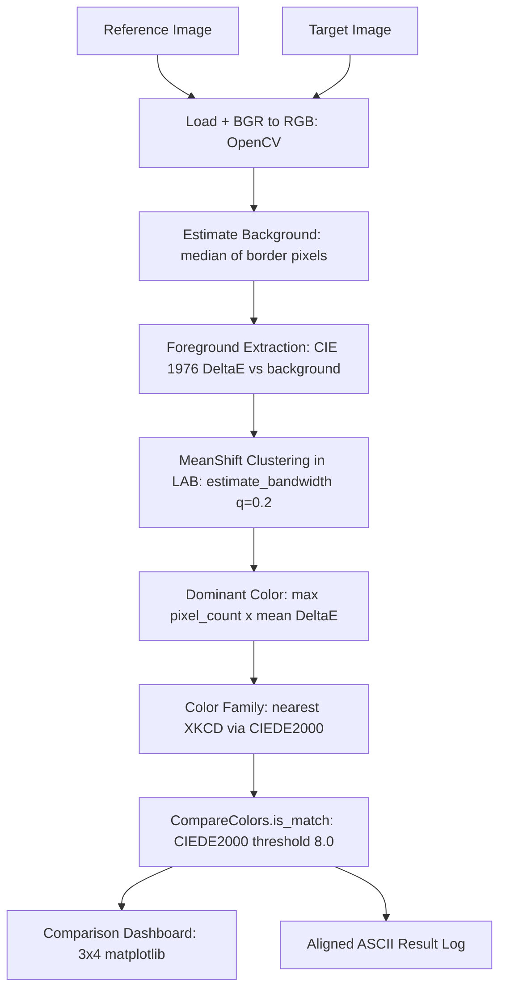
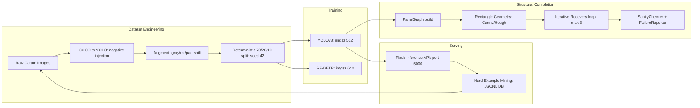
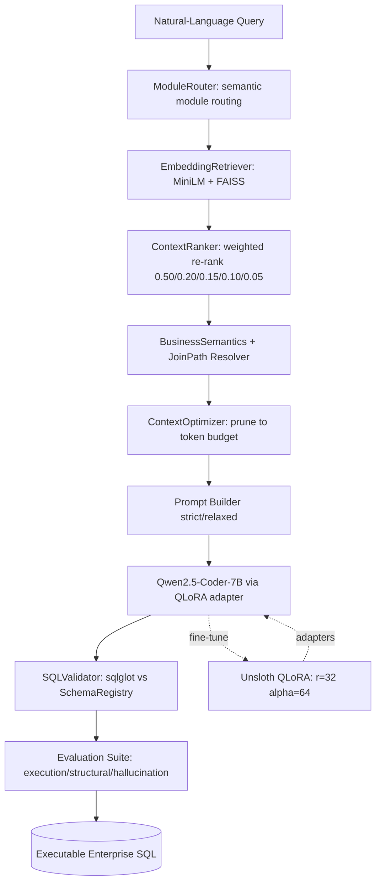
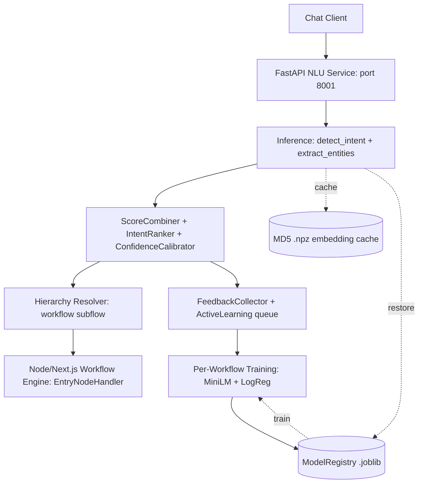

# Technical Internship Report

### Computer Vision, MLOps & Applied NLP Engineering Portfolio

---

<p align="center">

**Organization:** Silvertouch Technologies Ltd.

**Engagement Type:** Summer Software Engineering Internship

**Tenure:** 26 May 2026 — 09 July 2026 (6-week program)

**Prepared by:** Engineering Intern

**Document Classification:** Professional / Technical

</p>

---

> **Document Purpose.** This report consolidates four independent engineering deliverables executed during the internship into a single, standardized technical record. Each module is framed around its *Problem Statement*, *Implementation Strategy*, and *Architectural Trade-offs*, and is accompanied by a Mermaid.js system diagram for visual reference. The objective is to present a coherent, industry-grade narrative of the technical scope, the competency surface, and the professional growth attained over the engagement.

---

## Table of Contents

1. [Executive Summary](#1-executive-summary)
2. [Technical Competency Matrix](#2-technical-competency-matrix)
3. [Module Deep-Dive I — Perceptual Text-Color Semantic Comparison](#3-module-deep-dive-i--perceptual-text-color-semantic-comparison)
4. [Module Deep-Dive II — Production YOLOv8 / RF-DETR Detection Pipeline](#4-module-deep-dive-ii--production-yolov8--rf-detr-detection-pipeline)
5. [Module Deep-Dive III — Enterprise Semantic SQL RAG & LLM Tuning](#5-module-deep-dive-iii--enterprise-semantic-sql-rag--llm-tuning)
6. [Module Deep-Dive IV — MyBot Custom NLU Microservice](#6-module-deep-dive-iv--mybot-custom-nlu-microservice)
7. [Learnings & Conclusion](#7-learnings--conclusion)
8. [Appendix A — Export & Rendering Guide](#appendix-a--export--rendering-guide)

---

## 1. Executive Summary

During the six-week engagement at Silvertouch Technologies, the technical focus spanned three adjacent engineering disciplines — **perceptual computer vision**, **MLOps-grade object detection**, and **applied NLP / LLM systems** — culminating in four production-adjacent deliverables. The work progressed along an increasing axis of system complexity: from a self-contained colorimetry pipeline, to a containerized multi-detector inference platform, to a research-grade semantic retrieval + LLM fine-tuning stack, and finally to a fully operational FastAPI microservice with active-learning capabilities.

The unifying theme across all four modules was the **replacement of brittle heuristic logic with perceptually- or semantically-grounded representations**. In Module I, raw RGB vectors were supplanted by CIE L\*a\*b\* colorimetry to resist lighting-induced drift. In Module II, hard-coded panel layout assumptions were replaced by a geometric reasoner that recovers missed detections. In Module III, flat vector search was upgraded to a hierarchical semantic router over FAISS with contextual pruning. In Module IV, a monolithic classifier was decomposed into a per-workflow, embedding-backed NLU layer with confidence-gated routing.

Collectively, the deliverables exercised the full lifecycle of ML systems engineering: dataset construction and leak prevention (Modules II/III), model training and fine-tuning (Modules II/III/IV), low-latency inference serving (Modules II/IV), containerization (Module II), evaluation and benchmarking harnesses (Modules III/IV), and feedback-driven continuous improvement (Module IV). The portfolio demonstrates competence in Python-centric stack integration, deterministic pipeline design, and the disciplined separation of experimentation from production code paths.

---

## 2. Technical Competency Matrix

The following matrix consolidates the technology surface across all four modules, classified by engineering category.

| Category | Technology | Modules | Primary Application |
|---|---|---|---|
| **Language** | Python 3.10 | I, II, III, IV | Primary implementation language |
| **Language** | SQL / DDL | III | Schema grounding for Text-to-SQL |
| **Language** | Bash / Shell | II, IV | Training orchestration, GPU waiters |
| **CV Framework** | OpenCV (`cv2`) | I, II | Image I/O, geometric transforms, edge detection |
| **CV Framework** | Ultralytics YOLOv8 | II | Object detection (8-class ontology) |
| **CV Framework** | RF-DETR (Nano/Small) | II | Transformer-based detection (2-class) |
| **CV Library** | scikit-image | I | LAB→RGB conversion |
| **Color Science** | colour-science | I | sRGB→XYZ→LAB, CIEDE2000 ΔE |
| **ML Framework** | PyTorch (`torch`) | II, IV | Model backbone & training runtime |
| **ML Framework** | HuggingFace Transformers | III, IV | LLM / embedding model interfaces |
| **ML Library** | scikit-learn | I, IV | MeanShift, LogisticRegression, clustering |
| **Embeddings** | SentenceTransformers (all-MiniLM-L6-v2) | III, IV | Dense semantic encoding |
| **Retrieval** | FAISS | III | Approximate dense vector index |
| **Fine-Tuning** | Unsloth + PEFT/LoRA (QLoRA) | III | 4-bit parameter-efficient tuning |
| **NLP** | spaCy (`en_core_web_sm`) | IV | NER + linguistic pipelines |
| **Web Framework** | FastAPI | III*, IV | Async API & microservice | 
| **Web Framework** | Flask | II | Containerized inference API |
| **Serving** | Uvicorn | IV | ASGI server |
| **Containerization** | Docker / docker-compose | II | Reproducible inference deployment |
| **Experiment** | Weights & Biases / TensorBoard | III | Training observability |
| **Validation** | sqlglot | III | SQL AST validation |
| **Data** | pandas / numpy / pyarrow | I, II, III, IV | Tabular & array processing |
| **Augmentation** | albumentations | II | Bbox-aware image augmentation |
| **Visualization** | matplotlib | I, IV | Dashboards & benchmark plots |
| **Typed Models** | Pydantic | IV | Schema validation |
| **Tooling** | pyright | II, IV | Static type checking |
| **Tooling** | joblib / .npz | IV | Model & embedding persistence |

\* *FastAPI is present in the Module III dependency set for the experiment studio; the production inference surface is Flask-based.*

---

## 3. Module Deep-Dive I — Perceptual Text-Color Semantic Comparison

> **Domain:** Computer Vision / Color Science · **Type:** Standalone Python CLI pipeline · **Status:** Complete & runnable

### 3.1 Problem Statement & Objective

The objective was to determine whether the **text color** of two cropped packaging images — a `reference` and a `target` — constitutes an acceptable visual match for quality-assurance workflows. The core difficulty is that conventional RGB distance metrics are **non-perceptually-uniform**: ambient shadow and print-vs-digital reproduction push RGB vectors apart even when the human-perceived hue is invariant. The pipeline therefore had to emulate the chromatic discrimination of the human eye, isolating the text foreground, extracting its dominant chromatic signature, and scoring the inter-image difference against a perceptually calibrated tolerance.

### 3.2 Technical Implementation Strategy

The pipeline converts imagery to **CIE L\*a\*b\*** space and scores the chromatic distance with the professional **CIEDE2000 ΔE** metric, treating a `ΔE₀₀ ≤ 8.0` as an acceptable match. The flow is:

1. **Preprocessing** — load via OpenCV (BGR→RGB); estimate background as the median of border pixels; extract the foreground mask using **CIE 1976** ΔE against the background.
2. **Clustering** — discover the dominant text color via **density-based MeanShift in LAB** (`estimate_bandwidth`, quantile `0.2`), scoring clusters by `pixel_count × mean_ΔE_from_background` to avoid background dominance.
3. **Color Processing** — select the highest-importance cluster; map it to a named family over the 949-color XKCD palette by vectorized CIEDE2000 nearest-neighbor search, then group into meta-families via keyword rules.
4. **Comparison & Output** — `CompareColors.is_match()` applies the CIEDE2000 threshold; results are logged as aligned ASCII and rendered to a 3×4 matplotlib comparison dashboard.

### 3.3 Key Challenges & Resolution

| Challenge | Resolution & Rationale |
|---|---|
| **RGB drift under non-uniform lighting** | Migration to CIE L\*a\*b\* decouples chromaticity (`a*`, `b*`) from lightness (`L*`), so shadow-induced luminance shift does not invalidate the hue comparison — the system mimics human perception rather than pixel math. |
| **Unknown number of distinct text colors** | MeanShift was selected over K-Means precisely because it requires **no preset cluster count**; it converges on true color density peaks in LAB space, making the extractor robust to variable artwork. |
| **Background contamination of dominant color** | Clusters are weighted by `mean_ΔE_from_background`, elevating foreground text over incidental background tones; a `[0,0,0]` fallback guards against empty foreground. |
| **Threshold inconsistency (1976 vs 2000)** | Foreground masking intentionally uses the cheaper CIE 1976 ΔE (per-pixel speed), while the match decision uses the more discriminative CIEDE2000 — a deliberate cost/accuracy trade-off documented in-code. |

### 3.4 System Architecture (Mermaid)



---

## 4. Module Deep-Dive II — Production YOLOv8 / RF-DETR Detection Pipeline

> **Domain:** Computer Vision / Data Engineering / MLOps · **Type:** Multi-pipeline detection system + Dockerized inference API · **Status:** Functional; iteration-heavy; Docker image deployable

### 4.1 Problem Statement & Objective

The objective was to construct a production-grade detection system for **pharmaceutical carton / packaging artwork recognition**, localizing an **8-class structural ontology** (Artwork, not_artwork, Front/Side/Back/Bottom/Top_Panel, Extra_Areas) to feed downstream OCR and prescription (Rx) pipelines. Two hard requirements drove the design: (a) **dataset integrity** — thousands of images demanded leak-free splits, strict ontology enforcement (no orphaned labels, stable class IDs), and controlled negative-sample injection; and (b) **detection completeness** — every structural panel must be recovered, and when a detector misses one, the system must *reason* about its location rather than fail silently.

### 4.2 Technical Implementation Strategy

The system is organized as three cooperating subsystems:

- **Dataset & Training Engineering** — `COCO↔YOLO` conversion, bbox-aware augmentation (grayscale, 180°/90° rotations, pad/shift), deterministic 70/20/10 splits by original ID (seed `42`), and dynamic negative-sample injection from a pre-existing scraped folder. Two detector families are trained: **YOLOv8** (Ultralytics, imgsz 512) and **RF-DETR** (Nano/Small, imgsz 640, 50 queries).
- **Structural Completion (most novel component)** — `CompletionEngine` builds a `PanelGraph` from detections, crops artwork, and extracts geometry via Canny + Hough + connected components (`RectangleDetector`, `RectangleFilter`). An **iterative loop** (`max_iterations=3`) identifies missing panels via `Validator`, then `PanelAssignment.assign()` scores `Matcher` candidates (size similarity, shared-edge length, center distance) against layout-rule anchors, injecting inferred `source=geometry_reasoner` panels before a final `SanityChecker` + `FailureReporter`.
- **Inference & Ops** — a **Flask API** (`/health`, `/predict`, `/batch`, `/info`) wrapping `ultralytics.YOLO` with env-driven `MODEL_PATH`, `CONF_THRESHOLD=0.25`, `IOU_THRESHOLD=0.7`, `IMG_SIZE=512`, containerized via `Dockerfile` (python:3.10-slim) and `docker-compose` (service `ml-inference`, port 5000). A **hard-example mining** pipeline classifies failures (missing / duplicate / false_positive / low_confidence) into a JSONL re-annotation DB.

### 4.3 Key Challenges & Resolution

| Challenge | Resolution & Rationale |
|---|---|
| **Missed panels break downstream OCR/Rx** | A geometric reasoner recovers omitted panels from layout rules + candidate matching instead of aborting — trading compute for completeness, which is non-negotiable in a QA pipeline. |
| **Dataset leakage across train/valid/test** | Splits are keyed by *original image ID* (seed `42`), not per-augmentation, preventing augmented variants of one carton from leaking across folds. |
| **Dual-detector maintenance overhead** | YOLOv8 (speed) and RF-DETR (transformer accuracy) are retained as parallel paths; the Flask surface standardizes on YOLO for serving while RF-DETR supports blind evaluation. |
| **Reproducible GPU deployment** | Docker + docker-compose with HEALTHCHECK and mounted model volume make the inference image portable to the target server; offline `wheels/` indicate air-gapped install support. |

> **Note on maturity.** The module is functionally complete but iteration-heavy: several parallel training variants (`train_20/30/50/feasibility/baseline/round_2`) and a few stubs (`benchmark.py`, `hard_example_mining.py` with mock ground truth on a 5-image demo) indicate active tuning rather than a frozen release. De-duplication is filename-hash based (`clean_front_back.py`), not perceptual-hash as implied by the parent README; the repository is also Windows-path-bound and not directly Linux-portable.

### 4.4 System Architecture (Mermaid)



---

## 5. Module Deep-Dive III — Enterprise Semantic SQL RAG & LLM Tuning

> **Domain:** RAG / LLM Fine-Tuning / Text-to-SQL / Information Retrieval · **Type:** Research pipeline + experiment harness + web studio · **Status:** Research / prototype (active iteration)

### 5.1 Problem Statement & Objective

The objective was to build a **Retrieval-Augmented Generation (RAG) pipeline that translates natural-language questions into enterprise SQL** over a government / banking schema (modules such as `GP_COVERAGE`, `COOPERATIVE`, `BANKS`, `EDUCATION`). Base LLMs hallucinate SQL when they lack the exact schema, and flat vector search collapses on large schemas. The system therefore needed a **hierarchical semantic router** that retrieves only the relevant DDL, business concepts, and SQL exemplars, assembles them into a constrained prompt, and fine-tunes the generator so output is faithful and executable.

### 5.2 Technical Implementation Strategy

The architecture composes three layers:

- **Semantic Retrieval** — DDL and business concepts are embedded with SentenceTransformers (`all-MiniLM-L6-v2`) and indexed in **FAISS** (`EmbeddingRetriever.fit/search`). A `ModuleRouter` routes the query to the correct domain module; `ContextRanker` re-ranks retrieved context with fixed weights (0.50 / 0.20 / 0.15 / 0.10 / 0.05) before assembly. `BusinessSemanticsResolver` and `JoinPathResolver` inject business meaning and join columns (with fallback) into the prompt.
- **Context Assembly & Optimization** — `ContextOptimizer` + `ContextRanker` prune and score DDLs, docs, and SQL examples to fit the context window; `prompt_builder` / `prompt_builder_strict` construct the generation prompt.
- **Generator Fine-Tuning** — **QLoRA** via Unsloth loads `Qwen2.5-Coder-7B-Instruct` in 4-bit (`load_in_4bit`), applies a PEFT LoRA adapter (`r=32`, `alpha=64`, `dropout=0.05`, all attention + MLP projection targets), and trains with `SFTTrainer` (`max_seq_length=2048`, 3 epochs, `lr=2e-4`, batch 2 × grad-accum 8). A **curriculum** mixes raw and synthetic join datasets (`build_join_curriculum.py`). Correctness is verified by `SQLValidator` (sqlglot AST vs `SchemaRegistry`) and a 15-module `evaluation/` suite (execution/structural match, hallucination detection, query-complexity classification).

### 5.3 Key Challenges & Resolution

| Challenge | Resolution & Rationale |
|---|---|
| **Schema hallucination on large databases** | A two-tier semantic router (module-level then table/column-level) restricts the generator's attention to retrieved context, dramatically reducing invalid table/column references. |
| **Context window overflow** | `ContextOptimizer` + weighted `ContextRanker` prune low-value DDL/docs before prompting, keeping only high-signal schema fragments within the 2048-token budget. |
| **Cost of full fine-tuning** | QLoRA (4-bit base + LoRA adapters only) makes 7B-parameter tuning feasible on modest GPU, and saves *adapters* rather than full weights for storage efficiency. |
| **Join-path blindness** | `JoinPathResolver` discovers join columns with an explicit fallback, so multi-table queries remain executable even when the primary join hint is absent. |

> **Note on maturity.** The module is a research-grade prototype: modules are well-factored and the experiment harness is extensive (ablation, retrieval-gap, context-loss audits), but `docs/` and the test stubs are empty, `studio/runs` is empty, and `qwen_generator.py` depends on an external OpenAI-compatible endpoint (e.g., vLLM) not bundled in-repo. Implementation detail differs from the parent README: actual `r=32/alpha=64` and a `ContextRanker` (vs. README's illustrative `r=16` and `IndexFlatL2`).

### 5.4 System Architecture (Mermaid)



---

## 6. Module Deep-Dive IV — MyBot Custom NLU Microservice

> **Domain:** MLOps / Microservices / NLP · **Type:** FastAPI NLU service (intent + entity) + offline experiments · **Status:** Mature & well-documented; runnable (`.venv`)

### 6.1 Problem Statement & Objective

The objective was a **standalone FastAPI microservice** providing two-model NLU for the "MyBot" workflow engine: **intent / sub-intent detection** and **entity extraction**. Positioned between a chat client and a Node/Next.js workflow engine (`EntryNodeHandler`), it routes user messages to the correct workflow subflow. The constraint was latency: a heavy monolithic model is too slow for instant chat intents, so the service required a lightweight, per-workflow-trainable NLU layer with caching, incremental retraining, multi-turn conversation management, feedback-driven active learning, and a benchmark suite. At delivery, `main.py` was at **v3.2 — "Per-Workflow Multi-Model with spaCy."**

### 6.2 Technical Implementation Strategy

The service is composed of tightly separated subpackages:

- **Training** — `train_intent_classifier` / `_incremental` fit a **SentenceTransformer (`all-MiniLM-L6-v2`) embedding + `sklearn.LogisticRegression`** per workflow; entities use spaCy `en_core_web_sm` NER + regex patterns (AppID/Phone/Email/Date) + per-entity binary `LogisticRegression`. A zeroshot cosine-similarity fallback covers unseen intents.
- **Inference & Ranking** — `detect_intent` / `extract_entities` feed a `ScoreCombiner` and `IntentRanker`; a `ConfidenceCalibrator` applies dynamic thresholds (accept ≥ 0.75 / clarify ≥ 0.50).
- **Conversation & Hierarchy** — `ConversationManager` + `ResolutionEngine` (`should_classify` / `ask_entity` / `fallback`) manage multi-turn state; `hierarchy/` resolves the correct workflow subflow.
- **Caching & Persistence** — `fingerprint.py` (MD5) keys embedding caches (`.npz`); `ModelRegistry` + `persistence.py` (`joblib`) save/restore per-workflow classifiers with backup/rollback; `knowledge_graph.py` gives O(1) lookups.
- **Feedback & Benchmark** — `FeedbackCollector` + uncertainty-queue `active_learning` drive continuous improvement; a 643-LOC `benchmark/` suite measures accuracy, latency, memory, scalability, and stress. HTTP surface: `routers/train.py`, `analyze.py`, `status.py`.

### 6.3 Key Challenges & Resolution

| Challenge | Resolution & Rationale |
|---|---|
| **Latency of monolithic NLU** | Embedding + lightweight `LogisticRegression` (not a heavy LLM) yields sub-millisecond classification; MD5-keyed `.npz` caches avoid recomputing embeddings. |
| **Retraining cost per workflow** | Per-workflow models + incremental training + `ModelRegistry` restore mean a workflow is retrained only when its fingerprint changes, not on every deploy. |
| **Ambiguous / low-confidence intents** | `ConfidenceCalibrator` gates accept/clarify/fallback, and `ResolutionEngine` drives targeted entity prompts instead of blind misrouting. |
| **Continuous quality drift** | Uncertainty-queue active learning funnels low-confidence predictions back into the dataset builder for re-annotation — closing the loop without manual triage. |

> **Correction vs. parent README.** The actual intent stack is **SentenceTransformer + LogisticRegression** (not TF-IDF + LinearSVC); entities use **spaCy NER + regex + per-entity LogisticRegression** (not CRF); caching is **MD5** (not SHA-256). The offline `experiments/` harness *does* use `TfidfVectorizer + LogisticRegression` — but that is a validation harness, not the live service. **Operational caveat:** `main.py` defaults to port **8001**, while `train.py` (CLI) targets **8000** — align before CLI training.

### 6.4 System Architecture (Mermaid)



---

## 7. Learnings & Conclusion

### 7.1 Professional Growth

The six-week engagement progressed from implementing isolated algorithms to architecting **production-adjacent ML systems**, and the principal growth was conceptual rather than syntactic:

- **Representation over heuristics.** Across all four modules, the highest-leverage decisions were about *what the model sees* — LAB colorimetry (I), geometric layout rules (II), hierarchical semantic routing (III), and embedding-backed intent space (IV). Choosing the right representation consistently outperformed tuning the downstream classifier.
- **Experimentation vs. production separation.** Module III's large `scripts/` harness and Module IV's offline `experiments/` folder established a discipline of isolating research code from the served path — a prerequisite for maintainable ML systems.
- **Completeness as a first-class requirement.** Module II's structural-completion reasoner instilled the principle that, in QA pipelines, *silent failure is worse than explicit recovery*, and that geometric priors can substitute for model capacity.
- **Operational rigor.** Containerization (II), confidence-gated routing (IV), and active-learning loops (IV) moved the work from "model works" to "service is dependable."

### 7.2 Technical Takeaways

| Theme | Takeaway |
|---|---|
| **Perceptual robustness** | Colorimetry/semantic embeddings resist the real-world noise (lighting, schema drift) that defeats raw pixel/vector baselines. |
| **Cost-aware modeling** | QLoRA and embedding+LogReg patterns deliver production-grade quality at a fraction of full-model cost/latency. |
| **Evaluation discipline** | Dedicated eval suites (execution match, hallucination detection, latency/stress benchmarks) are what convert prototypes into defensible systems. |
| **Reproducibility** | Deterministic seeds, Docker images, and model registries are non-optional for handoff. |

### 7.3 Closing Statement

The internship delivered four technically distinct yet philosophically aligned systems, each demonstrating the substitution of perceptually- or semantically-grounded representations for brittle heuristics, wrapped in engineering practices suitable for production handoff. The portfolio evidences competency across the computer-vision, MLOps, and applied-NLP stacks and a disciplined approach to the full ML lifecycle — from dataset integrity through training, low-latency serving, and continuous improvement.

---

## Appendix A — Export & Rendering Guide

This document is authored in GitHub-flavored Markdown with embedded **Mermaid.js** diagrams. To render a high-quality PDF:

**Option 1 — VS Code (recommended, zero-config):**
1. Install the *Markdown Preview Mermaid Support* extension (and optionally *Markdown PDF*).
2. Open this file → right-click → *Markdown Preview* → *Print* → *Save as PDF*. Mermaid blocks render natively in the preview pane.

**Option 2 — Pandoc (scriptable):**
```bash
# Requires: pandoc, a mermaid filter (e.g. mermaid-filter) or mermaid-cli (mmdc)
pandoc Silvertouch_Internship_Technical_Report.md \
  -o Silvertouch_Internship_Technical_Report.pdf \
  --pdf-engine=wkhtmltopdf \
  --metadata title="Silvertouch Internship Technical Report"
```
> For Mermaid rendering under Pandoc, pre-process with `mmdc` or use the `pandoc-filter` for Mermaid, or convert Mermaid blocks to images first.

**Option 3 — Typora / Obsidian:**
Both editors render Mermaid in live preview and export to PDF via *File → Export → PDF*.

**Tip:** If your target PDF engine does not support Mermaid, replace each ` ```mermaid ` block with a pre-rendered PNG/SVG (e.g., via `npx @mermaid-js/mermaid-cli mmdc -i diagram.mmd -o diagram.png`) and embed it as an image.

---

*End of Report*
